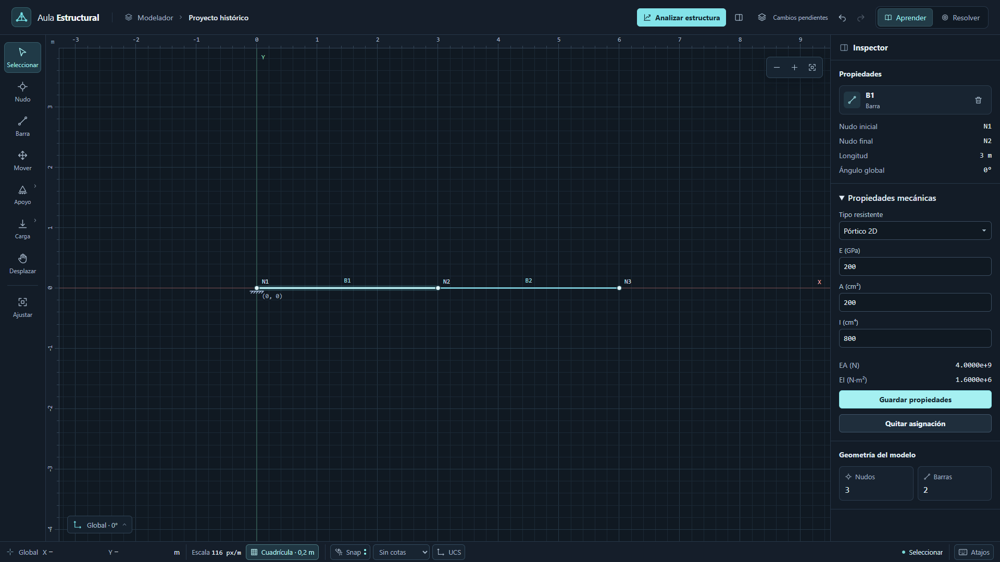
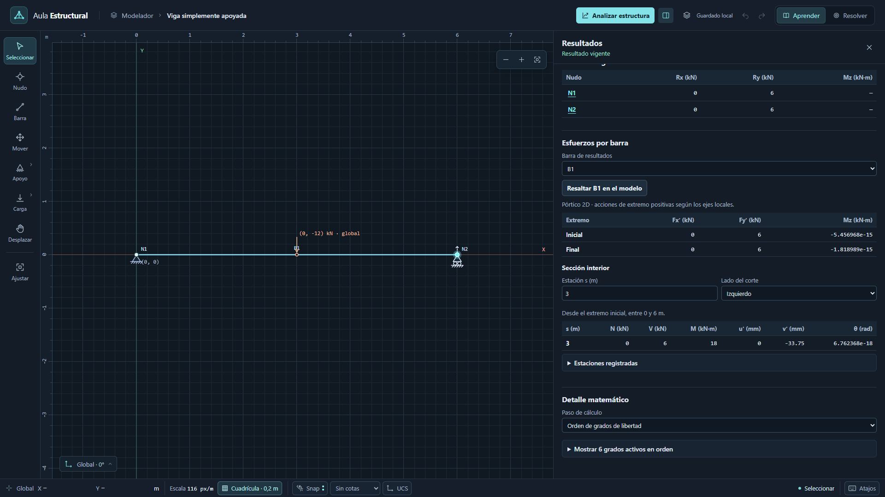
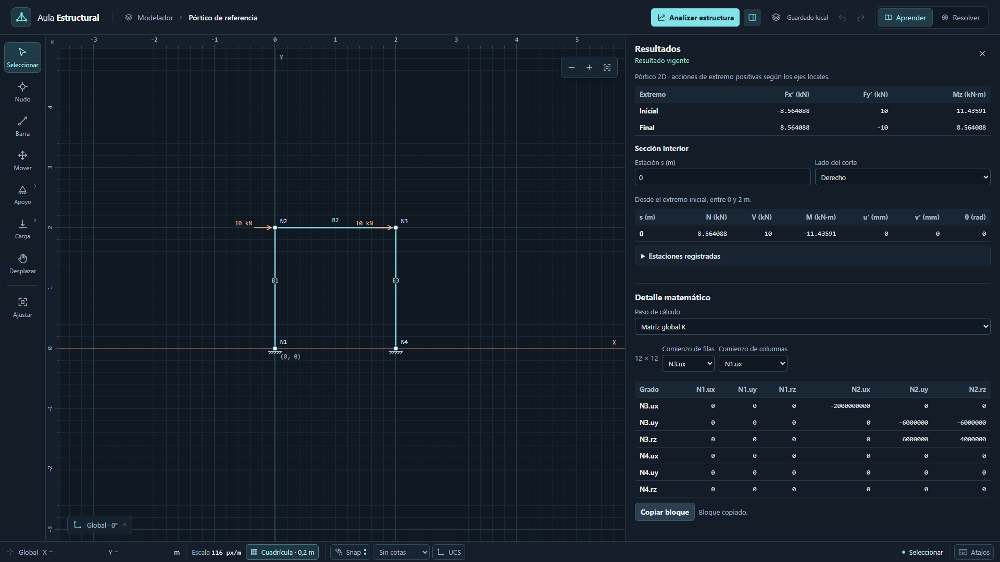

# Hitos 4.4 y 4.5 · Integración, propiedades y resultados

## Alcance y arquitectura

El flujo del CAD utiliza el motor de rigidez verificado del Hito 4.3. Permite editar mecánica, analizar armaduras y pórticos en un Worker local y consultar resultados por ID. La intervención sigue las convenciones de signos, coordenadas y cargas físicas aprobadas y conserva las herramientas, el historial y la persistencia de los hitos previos. [Arquitectura de análisis](HITO_4_ANALYSIS_ARCHITECTURE.md) · [Motor 4.3](HITO_4_3_FRAME_ENGINE.md) · [Aceptación 2](HITO_2_FINAL_ACCEPTANCE.md) · [Aceptación 3](HITO_3_FINAL_ACCEPTANCE.md) · [Documento maestro](requisitos/DOCUMENTO_MAESTRO_2026-11-21.md) · [Adenda](requisitos/ADENDA_REQUISITOS_2026-11-21.md)

| Componente | Responsabilidad |
| --- | --- |
| [Dominio mecánico](../src/domain/mechanics.ts) | Conversión explícita de unidades, validación, confirmación de ediciones en lote y eliminación de asignaciones. |
| [Editor e historial](../src/modeler/tools/editor.ts) | La geometría, los apoyos, las cargas y las propiedades se confirman juntos en `Structure`. |
| [Documento](../src/projects/document.ts) y [repositorio](../src/infrastructure/projectStore.ts) | Validación completa, migración, escritura atómica y control de revisión entre pestañas. |
| [Preparación](../src/projects/analysisInput.ts) | Instantánea validada, detección de pendientes y revisión física reproducible. |
| [Worker](../src/analysis/analysis.worker.ts) y [sesión de cálculo](../src/app/results/useAnalysis.ts) | Ejecución de `solveAnalysis`, cancelación e identificación de respuestas. |
| [Resultados](../src/app/results/ResultsPanel.tsx) y [traza](../src/app/results/TraceView.tsx) | Tablas, estación de pórtico, diagnóstico y navegación con la selección CAD. |

## Propiedades e historial

El Inspector permite elegir `truss2d` o `frame2d`, introducir propiedades y verificar EA o EI cuando corresponda. Se muestran GPa, cm² y cm⁴ y se aplican factores (10⁹), (10⁻⁴) y (10⁻⁸) para convertir a Pa, m² y m⁴ en Float64. El borrador se confirma explícitamente. En selección múltiple, se aplican los campos editados y se conservan las diferencias de los demás. Una transición a armadura retira I. Un campo borrado se guarda como pendiente y se puede volver a completar.

Las asignaciones se identifican por el `barId` estructural. Copiar y pegar usa los IDs de las nuevas barras. Dividir retira la asignación original y heredan sus valores los dos tramos con ID nuevo. Invertir conserva la asignación. Eliminar una barra limpia la asignación, también si la barra se elimina al borrar un nudo. El historial recupera cada edición confirmada de forma atómica con la misma instantánea de geometría, apoyos, cargas y propiedades.

## Esquema y migración

El documento de proyecto sube de `schemaVersion: 1` a `schemaVersion: 2` y conserva la forma de la raíz, los datos físicos previos y las preferencias. La sección nueva es `model.mechanics`. Su propia versión es 1.

```json
{
  "version": 1,
  "assignments": [
    { "barId": "B1", "kind": "frame2d", "E": 200000000000, "A": 0.02, "I": 0.000008 },
    { "barId": "B2", "kind": "truss2d", "E": 200000000000 }
  ]
}
```

El ejemplo B2 queda pendiente de A. Omitir una asignación completa deja pendiente también el tipo. Se rechazan valores presentes no finitos o no positivos, versiones desconocidas, barras inexistentes y referencias duplicadas.

La migración de v1 conserva el ID y las fechas del documento, además de los IDs, etiquetas, conectividad, apoyos, orientaciones, cargas e intervalos físicos, contadores y preferencias originales. Completa únicamente la sección con una lista vacía. IndexedDB conserva la versión 1 de la base y los almacenes existentes. Los registros v1 se validan y se migran en memoria al leer, y se escriben como v2 con un guardado explícito o un cambio confirmado. La escritura comprueba la revisión esperada y valida el registro anterior. Una migración fallida conserva el registro de origen. Al importar, un ID disponible se conserva y una colisión se resuelve creando una copia con ID nuevo dentro de la transacción. Las fechas de origen se conservan al importar.

## Contrato de cálculo y vigencia

Para cada cálculo, la aplicación valida el estado confirmado y forma `AnalysisInput` con estructura, asignaciones completas, caso activo y revisión. Si faltan datos, el diagnóstico identifica las barras y los campos. El Worker aplica `solveAnalysis` y devuelve el resultado con la revisión de origen. Las únicas adiciones a la salida del motor son la matriz axial local de armadura y su transformación en la traza pedagógica. La resolución y los oráculos matemáticos se conservaron.

La revisión física es una clave canónica por IDs que contiene coordenadas, conectividad ordenada de los extremos, apoyos, cargas, mecánica y caso activo. El orden de almacenamiento, las etiquetas, la vista, el UCS y Snap quedan fuera. Al cambiar la revisión se invalidan las tablas y se cancela cualquier Worker pendiente. Cada ejecución recibe también un identificador para descartar respuestas atrasadas de la misma revisión. Una invalidación permanece visible aunque se deshaga después el cambio. El usuario puede ejecutar de nuevo para confirmar los valores. Cada proyecto tiene su propia sesión de cálculo.

Estados visibles · **Sin análisis**, **Datos incompletos**, **Analizando**, **Resultado vigente**, **Resultado desactualizado** y **Análisis fallido**.

## Panel y traza

**Resultados** es un área independiente del Inspector. Presenta tipo de modelo, nudos, barras, grados activos y libres, condición numérica, diagnósticos y equilibrio. Las tablas muestran traslaciones en mm, giro en radianes, fuerzas en kN y momentos en kN·m. El selector de barra sigue la selección del lienzo. Los IDs de las tablas y diagnósticos pueden activar la selección CAD.

En pórticos, el panel presenta las acciones locales de extremo y consulta N, V, M, u′, v′ y θ en una estación física mediante `evaluateFrameSection`. Se puede elegir el lado del corte. Los valores se formatean para pantalla con hasta siete cifras significativas. En **Aprender**, los bloques copiados conservan la precisión original del dato.

**Resolver** muestra tablas y balances. **Aprender** añade orden de grados de libertad, rigidez y transformación local, aporte al ensamblaje, cargas equivalentes, K, F, Q, sistema reducido y explicación de la recuperación. Los bloques visibles tienen hasta seis filas y seis columnas. Las matrices se abren por paso y los bloques se copian como TSV.

## Evidencia visual







## Matriz de aceptación

| Criterios de la solicitud | Evidencia | Estado |
| --- | --- | --- |
| 1–3 · E/A/I, conversión y advertencias | Pruebas de dominio y documento. Playwright verifica el rechazo de I negativa y la identificación de B1 pendiente. | Conforme |
| 4–7 · Selección individual y múltiple, lote e historial | Playwright verifica valores comunes, diferencias, cancelación y Undo/Redo del lote. | Conforme |
| 8–13 · Copia, división, inversión, eliminación, Undo y Redo | Las transacciones se verifican en Vitest por identidad de instantánea y por IDs de las asignaciones. | Conforme |
| 14–16 · Migración íntegra y recarga | Los ejemplos v1 se comparan íntegramente después de migrar. Playwright carga un registro v1 directo de IndexedDB, verifica que permanece intacto hasta guardar y recupera propiedades v2. | Conforme |
| 17–20 · Intercambio, validación, identidad y concurrencia | Importación y exportación de proyectos completos, diagnóstico de barra inexistente, preservación de identidad y fechas, y conflicto entre pestañas. | Conforme |
| 21–23 · Armadura axial, triangulación y rodillo inclinado | La interfaz reproduce 0,1 mm de extensión en la axial, −0,1829072 mm en el vértice triangular y reacciones −10/+10 kN en el rodillo inclinado de referencia. | Conforme |
| 24–26 · Viga, voladizo y pórtico | Se verifican en interfaz la flecha de −33,75 mm y M = +18 kN·m en la viga, uy = −36 mm y Mz = +24 kN·m en el voladizo, y los desplazamientos y reacción del pórtico de referencia. | Conforme |
| 27–29 · Mecanismo, pendientes y diagnósticos | El mecanismo y las asignaciones incompletas no generan tablas. Se muestran las referencias disponibles. | Conforme |
| 30–33 · Vigencia, controles visuales, respuestas y proyectos | Pruebas de revisión semántica, cambio de caso y propiedad, zoom/pan/Snap y respuestas encoladas tras cancelar o repetir. El cambio de proyecto inicia sin análisis. | Conforme |
| 34–38 · Tablas, secciones, enlace CAD y traza | Playwright verifica valores, saltos de cortante, selección bidireccional, bloques y copiado TSV. | Conforme |
| 39–40 · Inspector contextual y regresión CAD | Suite completa de interfaz, incluidos anchos reducidos, herramientas previas y persistencia. | Conforme |

## Verificación

| Control | Línea base | Incremento |
| --- | --- | --- |
| Vitest | 134 aprobadas | 142 aprobadas. |
| Playwright en Edge | 35 aprobadas | 41 aprobadas, incluidas 6 pruebas de integración. |
| TypeScript | Aprobado | `tsc --noEmit` aprobado. |
| Compilación Vite | Aprobada | Producción aprobada, incluido el Worker. |

La suite base incluye los oráculos de armadura y pórtico. Los resultados esperados de las pruebas numéricas se conservaron. Las capturas se tomaron en Edge sobre la compilación de producción.

## Límites

El caso activo, la traza, los resultados y la selección se conservan durante la sesión. Al abrir o recargar un proyecto se puede calcular de nuevo con su modelo guardado. El motor mantiene su límite de 1024 grados activos y las restricciones de cargas y formulación de 4.3. El navegador debe admitir Workers de módulo. Diagramas AVM completos, deformadas gráficas, catálogos, métodos adicionales, segundo orden y servicios remotos quedan para etapas posteriores.

[Guía de usuario con ejercicio reproducible](USER_GUIDE.md)
