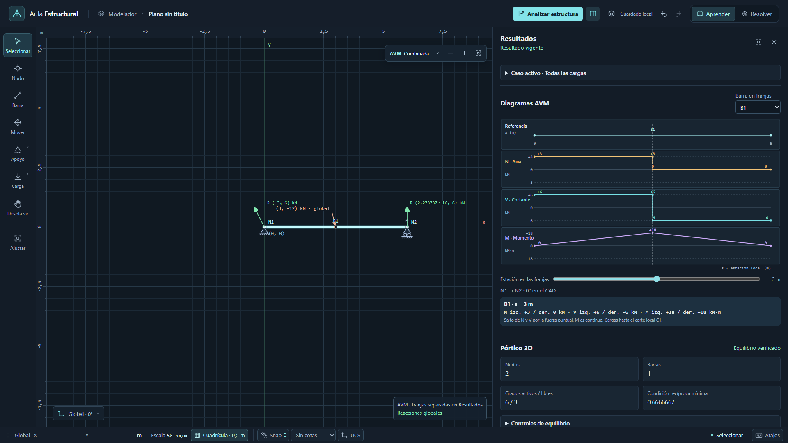
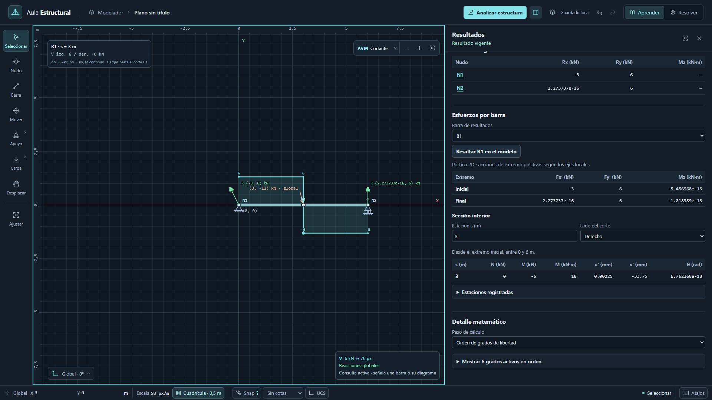
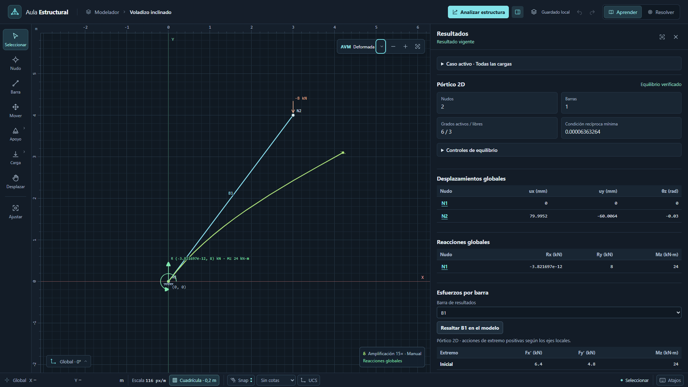
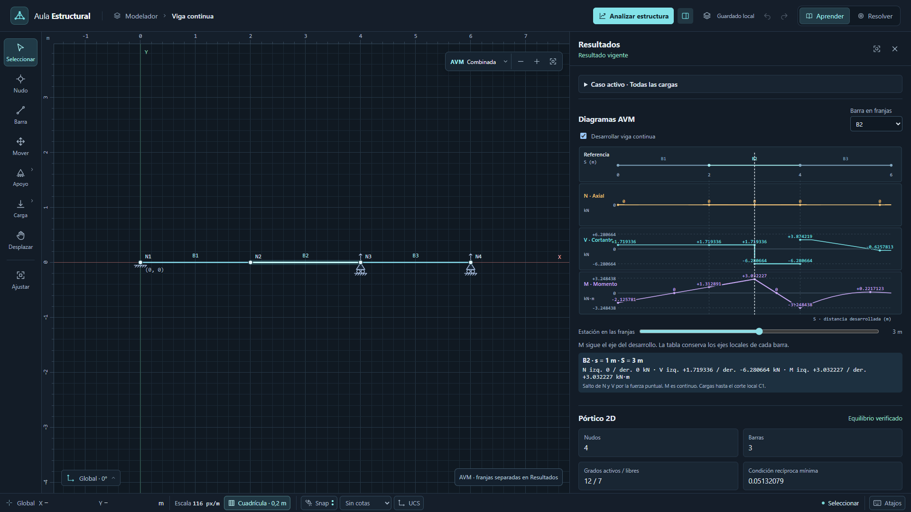
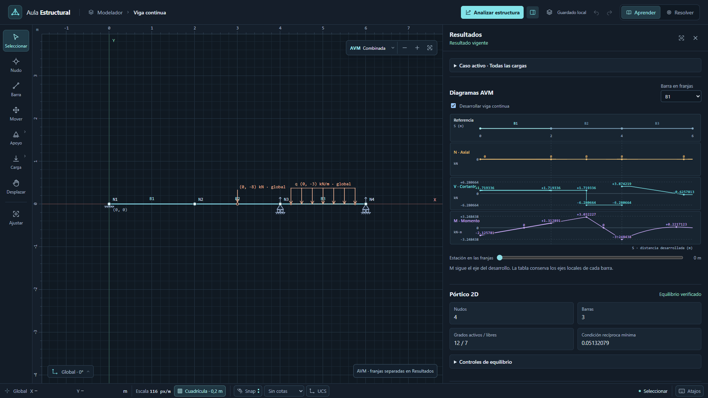
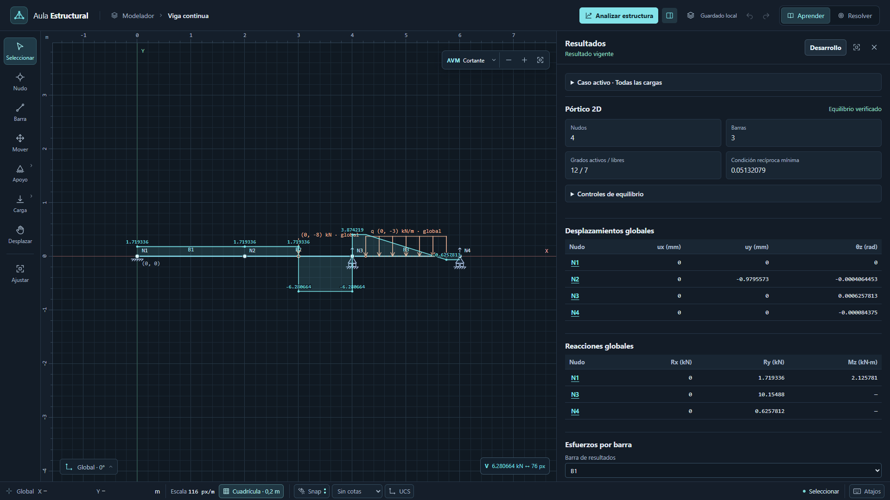
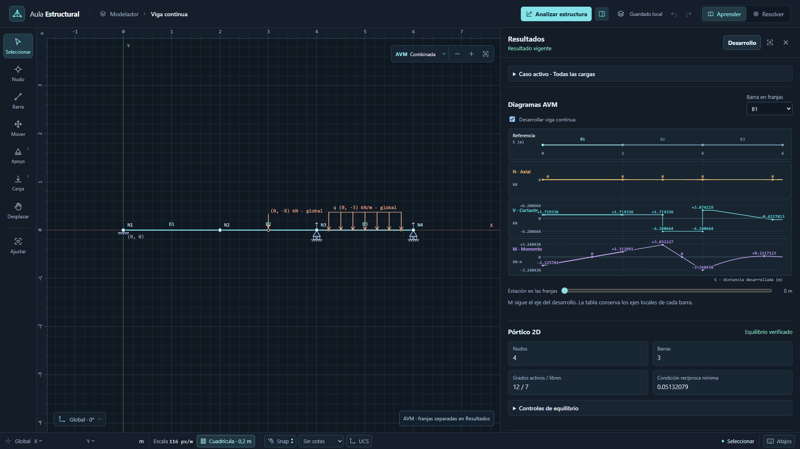

# Hito 4.6 · Diagramas AVM y deformada

## Flujo de uso

1. Crea la estructura, asigna apoyos y cargas, y confirma las propiedades mecánicas de sus barras.
2. Pulsa **Analizar estructura**. El primer cálculo abre la vista axial individual si aún no elegiste una vista. En la barra del lienzo, el botón **AVM** recorre Modelo, A, V, M, AVM combinada y Deformada. La flecha abre la selección directa y las opciones de capas.
3. En una vista individual, ajusta **Amplitud AVM** y alterna cargas aplicadas, reacciones, etiquetas o geometría original. **AVM combinada** abre las franjas separadas en Resultados. **Ampliar panel de resultados** da más espacio a las franjas. En **Deformada**, alterna la geometría deformada y elige amplificación automática o manual.
4. Activa **Consultar en el lienzo** y usa **Seleccionar** para leer un corte en una vista individual. En la vista combinada, pulsa una franja o usa el deslizador de estación. La tabla del pórtico toma la estación seleccionada. También puedes escribir una estación en la tabla y confirmarla con **Entrar** o al salir del campo.

## Signos y capas SVG

- **N** en kN. Tracción positiva y compresión negativa. Una armadura presenta axial constante.
- **V** en kN. En la cara derecha de la porción izquierda del corte, V positivo actúa hacia −y local. Se conserva el salto en las fuerzas puntuales. En armaduras V carece de significado dentro de la formulación.
- **M** en kN·m. Se usa el momento interno del corte, positivo sagante. El signo de una reacción de momento o acción de extremo se consulta por separado. En armaduras M carece de significado dentro de la formulación.

Para una barra de tangente unitaria `(cos θ, sin θ)`, la base de la estación s se obtiene mediante `Pi + (s/L)(Pj−Pi)`. Se proyecta a píxeles CSS con la cámara CAD. La ordenada gráfica h se suma en la dirección de pantalla `(−sin θ, −cos θ)`, con Y invertido por SVG. Los signos del campo se conservan y la ordenada positiva apunta hacia +y local de la barra. El CAD muestra un único tipo de esfuerzo a la vez.

`StructureLayer` conserva la geometría CAD, las previsualizaciones y las cargas. La capa AVM añade trazados, marcas, deformadas y reacciones en un grupo SVG independiente con `pointer-events="none"`. La cámara y la selección son comunes a ambas capas. Las reacciones usan sus componentes globales para la dirección de la flecha y el signo de Mz para el arco. La geometría original y las cargas aplicadas son capas con controles independientes. El trazado y la consulta conservan el modelo físico. [Capa AVM](../src/modeler/results/AVMLayer.tsx)

## Vista combinada en franjas

La vista AVM coloca la referencia longitudinal, N, V y M en cuatro franjas separadas del panel Resultados. Las cuatro comparten la misma proyección horizontal y la misma guía de estación. Cada magnitud conserva una escala vertical global y rotulada en kN o kN·m. Las curvas reutilizan los segmentos y saltos de la vista individual. En armaduras, V y M aparecen como franjas sin aplicación, incluso cuando estas barras forman parte de un conjunto mixto. [Franjas AVM](../src/app/results/CombinedDiagrams.tsx)

**Desarrollar viga continua** aparece cuando la barra pertenece a un camino conectado por ID, colineal, sin bifurcaciones, ciclos ni retrocesos. La coordenada desarrollada S acumula las longitudes desde un extremo geométricamente estable. Seleccionar otro tramo no cambia este origen. En un pórtico general se muestra una sola barra con su s local y el ángulo que tiene en el CAD. Los extremos coincidentes de distinto ID conservan su independencia.

Al desarrollar una barra cuyo eje local va en sentido contrario a S, se invierte la coordenada longitudinal y se presenta M con el signo asociado al eje del desarrollo. N y V conservan su signo con la convención de corte aprobada. La tabla mantiene el eje local de cada barra y el panel indica la diferencia cuando corresponde. La selección por ID, la conversión entre s y S y las curvas se derivan de los resultados ya calculados. [Conectividad y estaciones desarrolladas](../src/modeler/results/developedSpan.ts)

## Escalas

El máximo absoluto de cada campo se calcula sobre los valores de extremo, los límites de intervalo y los extremos interiores de **todas** las barras aplicables. En el CAD, la leyenda indica el esfuerzo de referencia y su equivalencia gráfica. Con amplitud 1×, los máximos globales corresponden a 54 px para N, 76 px para V y 98 px para M. La amplitud visual se ajusta entre 0,25× y 3×. Por ejemplo, dos fuerzas axiales de 10 kN y −5 kN se representan con 54 px y −27 px a 1×. En Resultados, cada franja presenta su propio cero y los límites ±máximo, conservando la comparación entre barras.

La deformada se construye a partir de los desplazamientos globales en nudos y la recuperación interior `evaluateFrameSection` en pórticos, incluyendo el efecto de las cargas interiores. Las armaduras interpolan el desplazamiento global de sus dos extremos. En nudos de pórtico, una marca discontinua indica el sentido de giro amplificado. La marca se acota gráficamente mediante el arco tangente de la pendiente amplificada y la rotación numérica permanece disponible en la tabla.

El factor automático apunta al 18 % de la longitud de la barra más larga, usando una referencia visual de desplazamientos nodales y muestras de sección. El factor manual amplifica ambos componentes en el espacio físico antes de proyectar. La leyenda distingue escala automática y manual. Si la referencia de desplazamiento es de hasta 10⁻¹² m, la vista indica desplazamientos despreciables y omite la deformada. La curva se subdivide según la desviación gráfica en cuatro puntos interiores, con umbral de 0,45 px y hasta ocho niveles por tramo. La estación y los resultados de tabla conservan la evaluación del motor.

## Ceros, extremos y discontinuidades

1. Las estaciones del motor separan el inicio, el final, los límites de distribuciones y ambos lados de las fuerzas puntuales.
2. Se buscan los extremos interiores de N y V a partir de los ceros de las intensidades axiales y transversales sumadas. Dentro de cada intervalo esas intensidades son lineales. Las magnitudes de los esfuerzos se evalúan con el motor.
3. Se separa V en tramos monótonos y se localiza `V = 0` para obtener los extremos candidatos de M. Se buscan los ceros de N, V y M en sus intervalos monótonos correspondientes. Se usa bisección de hasta 64 iteraciones o hasta agotar la resolución de Float64, con un umbral de detección en los extremos del intervalo de 64ε por la escala evaluada. El algoritmo conserva los cambios de signo entre los dos lados de un salto como discontinuidades.
4. Cada tramo de N y V es de grado máximo dos y el de M, de grado máximo tres. Se reconstruyen sus ordenadas cúbicas de Bézier con evaluaciones del motor en los extremos y en 1/3 y 2/3 del tramo. Los saltos se dibujan con un enlace vertical en la misma estación. Los máximos, mínimos y ceros proceden de los campos y quedan disponibles con independencia del zoom y de la cantidad de rótulos visibles.

## Consulta, aprendizaje y vigencia

Con la consulta activa, un clic simple de **Seleccionar** puede proyectarse sobre el eje local de la barra y ajustar la estación a un extremo, cero o salto cercano en pantalla. El marcador señala la sección física. Cerca de un salto se consultan los dos lados y la tabla permite escoger el lado que se resalta. Se conserva la selección por ID. Los modificadores, las ventanas de selección y las herramientas CAD siguen sus operaciones habituales. La consulta, el zoom, el pan y las opciones de visualización quedan fuera de Undo/Redo.

En Resultados, un clic o el deslizador ajusta una sola estación compartida por las franjas. La guía vertical atraviesa los tres campos. Al pasar de una barra a otra, se resalta la misma barra en el CAD y la tabla toma su estación local. Las etiquetas visuales son opcionales. La guía y la lectura explícita se mantienen disponibles con las etiquetas ocultas.

**Resolver** muestra los valores del corte. **Aprender** añade las relaciones `N′ = −qx`, `V′ = qy`, `M′ = V` o las relaciones de salto, con los IDs de cargas de barra que contribuyen hasta el corte cuando existen. El panel de resultados conserva las matrices y balances del Hito 4.4.

La capa gráfica recibe exclusivamente un resultado **vigente** de la sesión de análisis. Cuando cambia la geometría, los apoyos, las cargas, las propiedades o el caso, se ocultan los trazados y la leyenda solicita un nuevo análisis. Las respuestas atrasadas mantienen la política de descarte del Worker. Al recargar la aplicación se reconstruyen las vistas con un nuevo cálculo. [Integración y revisión semántica](HITO_4_4_4_5_INTEGRATION.md)

## Evidencia visual

## Matriz de aceptación

| Criterios de la solicitud | Evidencia independiente | Estado |
| --- | --- | --- |
| 1–4 · Axial | Armaduras a ±10 kN, pórtico a tracción, salto de +6 a −6 kN por fuerza axial interior y cruce continuo bajo carga uniforme. | Conforme |
| 5–10 · Cortante | Salto central de +6 a −6 kN. Ceros para carga uniforme, triangular y parcial. Extremo de V bajo intensidad lineal con cambio de signo. | Conforme |
| 11–18 · Momento | Viga con 18 kN·m en el corte central y M continuo. Uniforme con máximo de 10 kN·m. Casos de voladizo, pórtico, cargas parciales e inversión de barra inclinada. | Conforme |
| 19–23 · Deformada | Desplazamiento axial PL/EA, flecha de voladizo y flecha de viga de −33,75 mm. Se comprueban los extremos, la inmovilidad del documento y el factor manual. | Conforme |
| 24–28 · Interacción | Playwright recorre las seis vistas, comprueba las franjas separadas y la alternancia de capas, y vincula la consulta del lienzo o de una franja con la tabla. | Conforme |
| 29–35 · Vigencia e integración CAD | Playwright comprueba desactualización al dibujar, zoom, pan, barra inclinada, consulta sin historial, recarga y nuevo cálculo, pendientes y mecanismo. | Conforme |

| Criterios de la adenda | Evidencia | Estado |
| --- | --- | --- |
| 1–3 · Alternancia, separación y ausencia de superposición | Prueba de interfaz del flujo completo. Una vista individual expone un esfuerzo CAD. La vista AVM dibuja cuatro franjas en Resultados y ningún esfuerzo en el lienzo. | Conforme |
| 4–5 · Alineación, unidades y escala | Una guía cruza las franjas en la misma coordenada. Los límites independientes de la viga de prueba son ±3 kN, ±6 kN y ±18 kN·m. | Conforme |
| 6–7 · Viga continua y pórtico inclinado | Se verifica el desarrollo de tres barras con orden 0–2–4–6 m, incluyendo el segundo tramo invertido. El pórtico inclinado se consulta por una barra y su estación local. | Conforme |
| 8–10 · Selección, saltos y extremos | Selección bidireccional, guía, tabla sincronizada y salto de cortante. Ceros y máximos bajo cargas uniformes, triangulares y parciales se contrastan con fórmulas independientes. | Conforme |
| 11–13 · Navegación, vigencia y regresión | Playwright verifica zoom y pan, bloqueo de resultados desactualizados y suite completa del CAD y el análisis. | Conforme |

## Verificación y límites

| Control | Línea base | Hito 4.6 |
| --- | --- | --- |
| Vitest | 142 aprobadas | 157 aprobadas, con 15 nuevas. |
| Playwright, Edge | 41 aprobadas | 46 aprobadas, con 5 nuevas. |
| TypeScript | Aprobado | `tsc --noEmit` aprobado. |
| Compilación Vite | Aprobada | Producción aprobada. |

Los oráculos de 4.2 y 4.3 se mantuvieron intactos. Las capturas corresponden a la aplicación compilada en Edge.

Para conservar legibilidad se reducen los rótulos en puntos cercanos y se limita el número visible por barra y magnitud. La consulta conserva acceso a sus valores. La amplificación automática de la deformada usa una referencia visual y la polilínea tiene un límite de subdivisión. El incremento conserva el alcance del motor lineal y el tratamiento de elementos y cargas de los hitos previos.

## Corrección de saltos en el Hito 5.1

### Reproducción y causa

La viga de tres barras colineales B1–B2–B3 tiene un apoyo intermedio en N3, B2 orientada de N3 a N2, fuerza puntual sobre B2 y carga repartida sobre B3. A ambos lados de N3, el motor entregaba cortantes distintos. Las franjas de cortante dibujaban cada barra en una ruta separada. En el CAD también se trazaban por separado y se usaba la normal nativa de cada barra. El enlace existente solo se activaba en estaciones de fuerzas puntuales interiores.

La prueba de Edge que exige un segmento SVG en N3 falló en la reproducción previa. Encontró cero segmentos. La captura ilustra la ruptura entre ramas.

### Geometría y tolerancia

`developedSpan.ts` identifica cadenas colineales por conectividad y obtiene los esfuerzos límite de barras vecinas. La representación usa la misma orientación longitudinal en ambos gráficos. Bajo inversión de los ejes locales, conserva N y V y transforma el signo de M para el desarrollo. Los extremos se comparan en N o N·m con el umbral `1e−6 + 128ε · max(|izq|, |der|, referencia global)`, independiente del zoom.

Un salto interior usa un tramo recto entre valores de la misma estación dentro de la ruta SVG. Un salto en un nudo usa un segmento SVG explícito con el color y el espesor de la curva. En CAD sigue la normal de la cadena. En franjas, y en vigas horizontales en CAD, el enlace queda vertical. Un nudo compartido sin discontinuidad numérica y los extremos coincidentes de distinto ID conservan ramas sin enlace. El motor y Undo/Redo quedan fuera de la operación de trazado.

Archivos de la corrección · `diagramFields.ts`, `diagramModel.ts`, `developedSpan.ts`, `AVMLayer.tsx`, `CombinedDiagrams.tsx`, `diagramFields.test.ts` y `tests/e2e/avm.spec.ts`.

| Criterios | Evidencia posterior |
| --- | --- |
| Salto interior, dos cargas coincidentes y consulta bilateral | Se verifica un solo segmento SVG recto para la resultante de −12 kN y los valores de ambos lados entregados por el motor. |
| Apoyo intermedio y barras orientadas en sentidos opuestos | En Vitest, la diferencia reproduce la reacción de N2. En Edge, el segmento de N3 existe en el CAD y en las franjas, con igual X y distinta Y en sus extremos. |
| Continuidad y ausencia de enlaces falsos | Carga distribuida, nudo libre sin carga concentrada, pórtico no colineal y nudos coincidentes con IDs distintos. |
| Escala y regresiones | El segmento permanece vertical tras cambiar el zoom. Las pruebas originales del motor y del CAD siguen pasando. |
