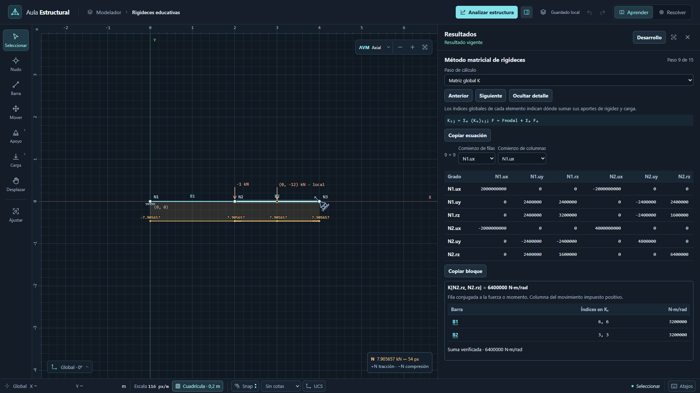

# Hito 5.1 · Método matricial de rigideces en Aprender

## Recorrido del estudiante

Con un resultado vigente, activa **Aprender** y abre **Desarrollo** en el panel de resultados. Usa **Anterior**, **Siguiente** o **Paso de cálculo** para navegar. **Ocultar detalle** mantiene la explicación breve del paso. Se pueden copiar las ecuaciones y los bloques visibles de las matrices. **Resolver** conserva los resultados, los balances, los diagramas y los diagnósticos del mismo análisis.

| Paso | Relación entre el modelo y el cálculo |
| --- | --- |
| 1. Nudos y elementos | Coordenadas referidas al primer nudo en ejes globales y conectividad identificada por ID. |
| 2. Grados de libertad | Orden de ux, uy y θz si hay un pórtico incidente. Cada entrada selecciona su nudo. |
| 3. Apoyos | Tipo y nudo. En el rodillo, los vectores normal restringido y tangente permitido proceden de la reducción ejecutada. |
| 4. Propiedades | E en Pa, A en m² e I en m⁴ cuando corresponde. |
| 5. Sistemas locales | Longitud en m, orientación inicial–final y cosenos directores. |
| 6. Rigidez local | Fórmula axial o bloques axial y flexional, orden local, sustitución de EA/L y EI y matriz local evaluada. |
| 7. Transformación | T y la relación entre grados de libertad globales y locales. |
| 8. Cargas equivalentes | Vector agregado e identificación de cada carga interior, su intervalo y su aporte en ejes locales y globales. |
| 9. Ensamblaje | K y F se consultan por bloques. Cada entrada de K muestra sus aportes elementales. Cada entrada de F muestra acciones nodales y equivalentes. |
| 10. Restricciones | Q relaciona movimientos permitidos con grados globales mediante `u = Q z`. |
| 11. Sistema reducido | Kr y Fr del componente conectado elegido. |
| 12. Desplazamientos | Coordenadas reducidas z y desplazamientos globales u recuperados por el motor. |
| 13. Reacciones | Vector `R = K u − F` en grados globales. |
| 14. Fuerzas internas | Acciones de extremo, convención de momento interno, evaluación de sección y cargas contribuyentes. **Ver sección en AVM** abre las franjas en la misma posición. |
| 15. Equilibrio | Residuos de fuerza y momento por componente y error hacia atrás de la solución. |

## Trazabilidad

Seleccionar un término de K resalta el nudo de la fila e identifica ambas coordenadas, unidades y signos. La tabla de aportes permite resaltar cada barra en el CAD. Los valores individuales son las entradas correspondientes de las matrices globales elementales del motor. La suma explicativa usa suma compensada y se compara con K con el umbral `1e−6 + 128ε Σ|Kₑᵢⱼ|`. El resultado global mostrado sigue siendo la entrada de K del análisis.

La traza ampliada expone conectividad y geometría relativa al primer nudo, parámetros mecánicos, longitud, orientación, u, R y datos de apoyo preparados por el solucionador. Los aportes de carga locales se capturan al formar el vector equivalente y se vinculan al ID de carga. La transformación a global usa la misma operación del ensamblaje. Las ecuaciones de rigidez, la reducción y los oráculos existentes se conservaron.

Las matrices se muestran en bloques de hasta seis filas y seis columnas. La navegación educativa, la selección y la consulta son de solo lectura. Si cambia el modelo físico o el caso de cálculo, el desarrollo deja de mostrarse hasta disponer de otro resultado vigente.

## Verificación

| Control | Línea base | Hito 5.1 |
| --- | --- | --- |
| Vitest | 157 aprobadas | 161 aprobadas. Incluye 4 pruebas nuevas de traza y discontinuidades. |
| Playwright en Edge | 46 aprobadas | 47 aprobadas. Incluye el recorrido educativo y las verificaciones SVG ampliadas. |
| TypeScript | Aprobado | `tsc --noEmit` aprobado. |
| Compilación | Aprobada | Vite de producción aprobado. |

Se contrastó la entrada de giro común de N2 con dos aportes independientes de (4EI/L), el vector equivalente de una carga central con su fórmula de Hermite, la transformación de una barra inclinada y el rodillo a 45° con sus vectores analíticos. También se comprobó el residuo de `Kr z − Fr`. En Edge se verificaron navegación, selección por IDs, copia, alternancia de modos, apertura de AVM desde la recuperación y desactualización sin cambios de historial.

La corrección de saltos y sus capturas están en el informe de 4.6. Los materiales, las secciones y el diseño normativo quedaron previstos para incrementos posteriores. [Corrección AVM](HITO_4_6_AVM_DIAGRAMS.md#corrección-de-saltos-en-el-hito-51) · [Hoja de ruta](DEVELOPMENT_ROADMAP.md#materiales-secciones-y-diseño-estructural)
