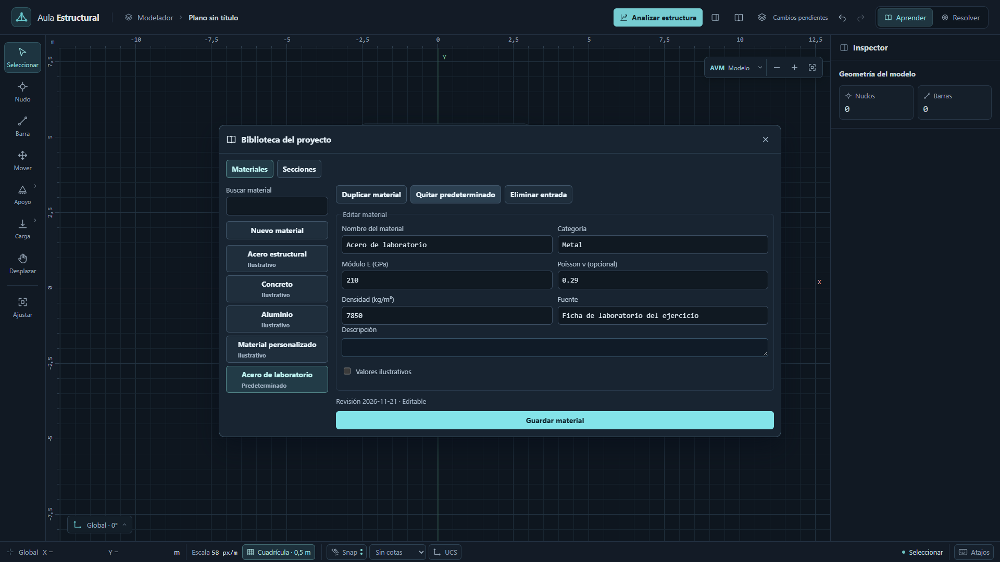

# Hito 5.2 · Biblioteca local de materiales y secciones

## Uso

Abre **Biblioteca de materiales y secciones** en la barra superior o en **Proyectos**. Cada proyecto tiene su biblioteca. Las pestañas permiten buscar, crear, editar, duplicar y eliminar entradas con confirmación. Una entrada vinculada a barras o elegida como predeterminada debe desvincularse antes de eliminarla.

La biblioteca incluye cuatro ejemplos editables. Sus valores son ilustrativos y la fuente identifica a Aula Estructural como origen del ejemplo. El proyecto nuevo y los proyectos migrados mantienen sus barras sin vínculos iniciales.

| Ejemplo | E (GPa) | ν | Densidad (kg/m³) |
| --- | ---: | ---: | ---: |
| Acero estructural | 200 | 0,30 | 7850 |
| Concreto | 25 | 0,20 | 2400 |
| Aluminio | 69 | 0,33 | 2700 |
| Material personalizado | 1 | — | — |

## Contratos y reglas

`Material` conserva ID, nombre, categoría, descripción, fuente, fecha ISO de revisión, estado editable y marca ilustrativa. La interfaz presenta E en GPa y lo guarda en Pa. E es finito y positivo. ν es opcional y debe quedar entre −1 y 0,5, con los extremos excluidos. La densidad opcional se guarda en kg/m³ y debe ser finita y positiva. Si una entrada importada está protegida, se puede duplicar como copia editable.

`Section` tiene identidad y geometría propias. Su contrato conserva `axes: centroidal-xy`, `unit: SI`, `calculationVersion: 1` y los valores geométricos. Las secciones paramétricas, las compuestas y las manuales comparten las reglas de asignación. [Fórmulas y editor de secciones](HITO_5_3_SECTION_EDITOR.md)

## Asignación y actualización

1. Selecciona una o varias barras y confirma su tipo resistente. En **Propiedades mecánicas → Asignación desde biblioteca**, elige material, sección o ambos. Si existen predeterminados elegidos por el usuario, el botón correspondiente los carga como borrador.
2. Para una sección asignada a pórticos, elige el eje centroidal x o y que coincide con el eje z local de flexión. Confirma el lote. La armadura obtiene A, y el pórtico obtiene A e I según el eje elegido. E se toma del material cuando este se asigna.
3. El Inspector muestra si la fuente es de biblioteca, manual o pendiente. Guardar E manual retira el vínculo de material. Guardar A o I manual retira el vínculo de sección y conserva los demás valores físicos. Al cambiar el tipo resistente se retira el vínculo de sección para elegir el eje de nuevo cuando corresponda.

Si una entrada vinculada cambia físicamente, el usuario debe marcar **Actualizar las barras vinculadas al confirmar** o editar una copia. La primera acción cambia la entrada y los valores efectivos de todas sus barras en un solo paso de historial. La segunda conserva las barras con la entrada original. Los cambios de nombre o descripción conservan la vigencia del resultado. Un cambio de vínculo o de propiedades físicas usadas invalida su revisión. Los predeterminados quedan disponibles para una asignación explícita.

Copiar, dividir e invertir conservan los vínculos por ID junto con E, A e I. Si una edición posterior del catálogo vuelve incompatibles las propiedades copiadas, el pegado se rechaza y solicita copiar de nuevo. Eliminar una barra retira sus asignaciones. Undo/Redo restaura propiedades, entradas y referencias del mismo estado del proyecto.

## Persistencia y análisis

JSON v3 añade `model.library` versión 1 y las referencias opcionales `materialId`, `sectionId` y `sectionAxis` a las asignaciones mecánicas. Las migraciones v1 y v2 conservan el modelo y sus IDs. Los valores E/A/I manuales de v2 se conservan como manuales, incluidos campos pendientes. IndexedDB mantiene sus almacenes y la comparación optimista de revisiones entre pestañas. Un registro inválido impide el guardado sobre ese estado.

La importación valida referencias, identificadores y valores. Las propiedades derivadas de sección se comprueban con el cálculo versionado. Para una asignación vinculada se comprueba que sus E, A e I efectivos sean coherentes con el catálogo. El motor recibe los valores escalares confirmados por el modelo. La densidad y ν permanecen como propiedades documentadas, sin generar peso propio ni intervenir en la formulación.

## Matriz de aceptación

| Alcance | Evidencia |
| --- | --- |
| Alta, búsqueda, edición, duplicación y eliminación | Edge verifica búsqueda, validación de ν, alta con fuente, predeterminado, cancelación de borrado, confirmación y recarga. |
| Vinculación, eje y selección múltiple | Edge asigna material y sección a dos barras, exige eje Iyy y comprueba invalidación. Vitest verifica referencias, eje y protección de entradas en uso. |
| Edición CAD e historial | Vitest cubre copia, división, inversión, rechazo de pegado incompatible y restauración. Edge comprueba Undo/Redo de asignación múltiple. |
| Persistencia | Vitest conserva E/A/I manuales y rechaza v3 incoherente. Edge verifica migración, recarga, ida y vuelta JSON, autorización para actualizar y conflicto entre pestañas. |
| Equivalencia | Vitest compara desplazamientos, reacciones, esfuerzos y caminos AVM con un proyecto manual de las mismas propiedades. Edge compara flecha y trazado M. |

Validación conjunta de 5.2 y 5.3 · 177 pruebas Vitest, 50 Playwright en Edge, TypeScript y compilación Vite de producción. La biblioteca es local al proyecto. Los catálogos sincronizados y las verificaciones normativas quedan reservados para incrementos posteriores.
