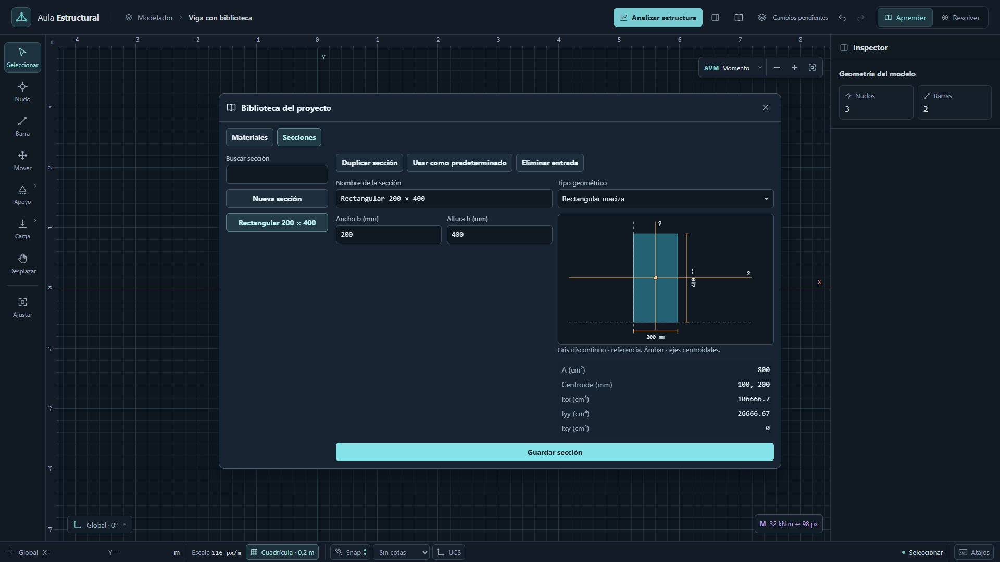
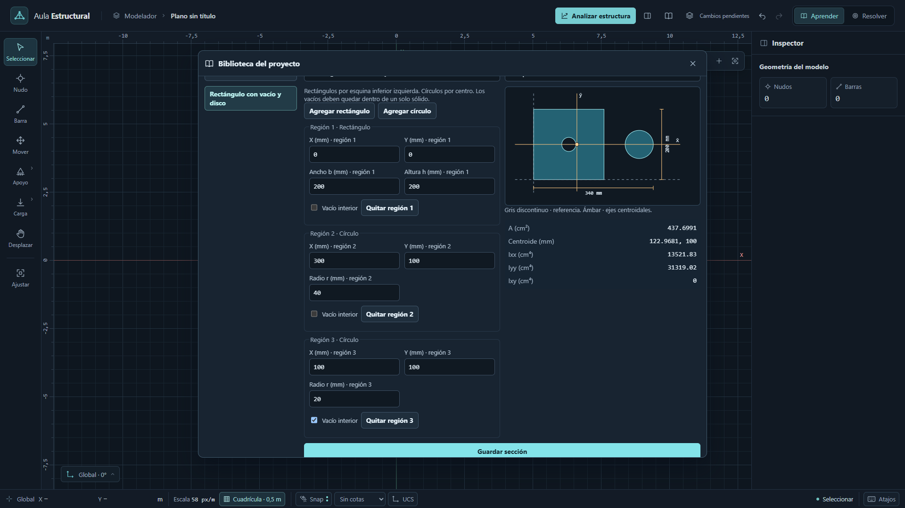

# Hito 5.3 · Editor geométrico de secciones transversales

## Uso y unidades

Abre **Biblioteca → Secciones → Nueva sección**. El tipo geométrico habilita los campos pertinentes. El editor presenta dimensiones en mm, área en cm² e inercias en cm⁴. La geometría y los resultados se guardan en SI. Al escribir dimensiones válidas, el SVG se adapta al contorno y muestra la envolvente acotada, los ejes de referencia visibles, el centroide y sus ejes. Guardar confirma la sección. Las geometrías inválidas permanecen en el borrador.

Una sección **Propiedades manuales** registra A, centroide, Ixx, Iyy e Ixy declarados por el usuario. Los valores deben ser finitos, con A, Ixx e Iyy positivas y una matriz de inercias definida positiva. La vista manual muestra sus valores y carece de contorno deducido.

## Fórmulas y ejes

Para un rectángulo de base b y altura h, `A = b·h`, `Ixx,c = b·h³/12` y `Iyy,c = h·b³/12`. Para un disco de radio r, `A = πr²` e `Ixx,c = Iyy,c = πr⁴/4`. Ambas primitivas tienen producto de inercia centroidal cero. Un tubo circular o rectangular resta el vacío concéntrico correspondiente al espesor declarado.

Los perfiles I, T, L y C se forman con rectángulos de alma y alas que comparten límites. I y T centran el alma. L toma la esquina inferior izquierda como origen. C ubica el alma a la izquierda. Las dimensiones se validan antes de formar los perfiles. El espesor del tubo y las dimensiones de alma o alas deben dejar regiones de área positiva.

En una sección compuesta, cada sólido aporta área positiva y cada vacío aporta área negativa. Los rectángulos se posicionan por la esquina inferior izquierda y los círculos por el centro. Primero se calculan los primeros momentos para encontrar `cx = Σ(Aᵢ xᵢ)/ΣAᵢ` y `cy = Σ(Aᵢ yᵢ)/ΣAᵢ`. Luego se aplica el teorema de ejes paralelos.

```text
Ixx = Σ [Ixx,cᵢ + Aᵢ (yᵢ − cy)²]
Iyy = Σ [Iyy,cᵢ + Aᵢ (xᵢ − cx)²]
Ixy = Σ [Ixy,cᵢ + Aᵢ (xᵢ − cx)(yᵢ − cy)]
```

Las inercias propias de un vacío llevan el mismo signo que su área. Se adopta `Ixy = ∫(x−cx)(y−cy)dA`. En el pórtico 2D, el usuario elige Ixx o Iyy según el eje centroidal que se alinea con z local de la barra. Ixy se informa como propiedad de la sección. La geometría, el centroide y los valores son independientes del SVG y de la vista del CAD.

## Validación geométrica

Las secciones compuestas admiten hasta 100 regiones. Los sólidos pueden tocarse y deben tener interiores disjuntos. Cada vacío debe quedar estrictamente dentro de un solo sólido. Los vacíos no pueden superponerse. El detector distingue rectángulo–rectángulo, disco–disco y rectángulo–disco. Cerca del contacto se admite un margen de pocas unidades de redondeo de Float64. Una región cuyo tamaño no se puede resolver a su distancia del origen se rechaza. Las dimensiones paramétricas y de primitivas se limitan al intervalo de 10⁻⁹ a 10⁶ m y las posiciones al intervalo de −10⁶ a 10⁶ m.

Los resultados se verifican antes de persistir. La versión 1 del cálculo se identifica dentro de cada entrada del esquema de proyecto v3. Se admiten regiones desconectadas sin solape para cálculo geométrico de una sección compuesta. Quedan fuera las uniones booleanas generales, los perfiles rotados dentro de una composición y los ejes principales.

## Ejemplos

- Rectangular de 200 × 400 mm. A = 800 cm², centroide (100, 200) mm, Ixx ≈ 106 666,67 cm⁴ e Iyy ≈ 26 666,67 cm⁴.
- Compuesta. Rectángulo de 200 × 200 mm, un disco de radio 40 mm centrado en (300, 100) mm, y un vacío de radio 20 mm centrado en (100, 100) mm. A = 400 + 12π cm². Si se mueve el disco hasta x = 180 mm, la validación detecta solape y el borrador no se guarda.





## Arquitectura y aceptación

`src/geometry/sections.ts` calcula propiedades y valida la topología. `SectionEditor` prepara borradores y `SectionPreview` proyecta la geometría calculada. `src/domain/library.ts` confirma entradas y cambios de barras. `document.ts` valida el documento y `analysisInput.ts` vincula la revisión física. [Integración y persistencia](HITO_5_2_MATERIAL_LIBRARY.md)

| Alcance | Evidencia |
| --- | --- |
| Ocho familias paramétricas | Vitest contrasta área, centroide, momentos y el producto de inercia del perfil L con referencias analíticas independientes. |
| Composición y ejes paralelos | Vitest comprueba área, centroide, Ixx, Iyy e Ixy con un sólido, un vacío y un disco desplazado. |
| Geometrías inválidas y unidades | Vitest verifica espesores, degeneración, contacto, solapes, contención y conversiones de mm a SI. |
| Editor SVG | Edge verifica edición dinámica, centroides, bloqueo de solape y guardado de una sección compuesta válida. |
| Integración estructural | Edge asigna la sección por Iyy y la recupera tras recarga e importación. Las pruebas de referencia del motor, CAD, AVM y Aprender conservan sus resultados. |

Validación conjunta · 177 pruebas Vitest, 50 Playwright en Edge, TypeScript y compilación de producción.
