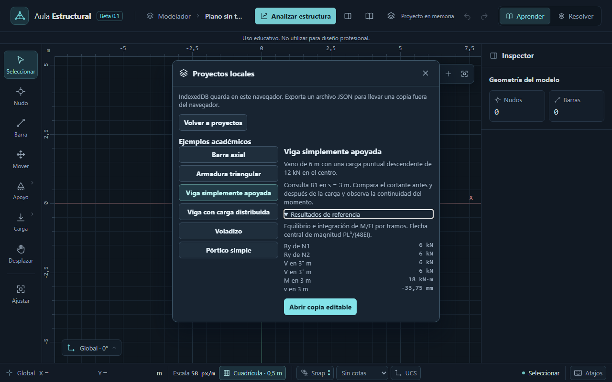
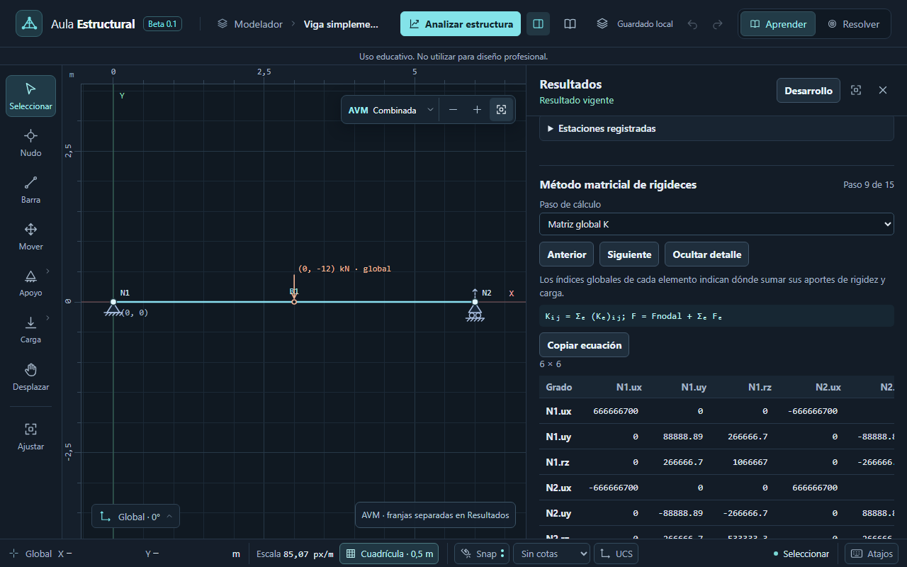

# Hito 6 · Auditoría de aceptación y experiencia académica

## Línea base y recuperación

La etiqueta local `respaldo-hito-6` apunta a `d8b517f`, cuyo árbol coincidía con el directorio de trabajo antes de editar. La rama de trabajo original conserva su historial, índice y cambios previos. La base obtuvo 177 pruebas Vitest y 50 Playwright en Edge, con TypeScript y producción correctos.

Se cotejaron las convenciones de coordenadas, cargas y conectividad, el alcance de Aprender y las pruebas anteriores. [Documento maestro](requisitos/DOCUMENTO_MAESTRO_2026-11-21.md) · [Adenda](requisitos/ADENDA_REQUISITOS_2026-11-21.md) · [Hito 2](HITO_2_FINAL_ACCEPTANCE.md) · [Hito 3](HITO_3_FINAL_ACCEPTANCE.md) · [Hito 4.6](HITO_4_6_AVM_DIAGRAMS.md) · [Hito 5.1](HITO_5_1_EDUCATIONAL_STIFFNESS.md) · [Hito 5.2](HITO_5_2_MATERIAL_LIBRARY.md) · [Hito 5.3](HITO_5_3_SECTION_EDITOR.md)

## Matriz de aceptación

| Requisito | Evidencia |
| --- | --- |
| Crear proyecto, nudos y barras | Playwright crea documentos, dibuja por clic y por entrada física exacta y recupera entidades por ID. [CAD](../tests/e2e/hito1.spec.ts) · [Proyectos](../tests/e2e/projects.spec.ts) |
| Snap, UCS, selección y coordenadas exactas | Ventanas en ambos sentidos, modificadores, selección mixta, movimiento conjunto, nudos coincidentes independientes y aplicación de Snap con zoom, pan y UCS. |
| Apoyos y acciones estructurales | Selección de apoyos a través de su nudo, rodillo inclinado, fuerzas y momentos nodales, puntual e intensidades uniformes y variables. La cota de la carga queda en metros. [Cargas](../src/domain/load.test.ts) · [Apoyos](../src/domain/support.test.ts) |
| Dividir, invertir, copiar, pegar y deshacer | Controles de resultante y momento estático al dividir, vectores físicos tras invertir, traslado de apoyos y cargas por ID, transacciones completas en el historial. [Edición](../src/domain/cadEdition.test.ts) · [Historial](../src/modeler/tools/history.test.ts) |
| Asignar material, sección y E/A/I | Altas y edición de catálogo, asignación en lote y por eje, edición manual, vínculos, equivalencia analítica y migración. [Biblioteca](../src/domain/library.test.ts) · [Interfaz](../tests/e2e/library.spec.ts) |
| Análisis, diagnóstico y vigencia | Oráculos estructurales, componentes inestables, caso activo, resultados tardíos, invalidación al cambiar el modelo físico y conservación al cancelar una operación sin confirmar. [Análisis](../tests/e2e/analysis.spec.ts) · [Recorrido académico](../tests/e2e/academic.spec.ts) |
| Desplazamientos, reacciones, AVM y deformada | N/V/M en el CAD, franjas separadas y escalas, continuidad de M y lados de V, salto por apoyo intermedio e inversión de barra, sincronización CAD y tablas, deformada amplificada. [Campos](../src/modeler/results/diagramFields.test.ts) · [AVM](../tests/e2e/avm.spec.ts) |
| Aprender y Resolver | Quince pasos del método, vínculo gráfico, tablas y cambio de modo en el flujo con una copia de viga. [Desarrollo](../tests/e2e/analysis.spec.ts) · [Recorrido](../tests/e2e/academic.spec.ts) |
| Guardar, recargar e intercambiar JSON | IndexedDB, conflictos entre pestañas, importación/exportación, migraciones 1→3 y 2→3, y conservación de un registro con esquema posterior. [Persistencia](../tests/e2e/projects.spec.ts) · [Pruebas de contrato](../src/projects/document.test.ts) |
| Seis ejercicios con referencias independientes | Cada modelo abre, se resuelve y conserva sus propiedades al exportar e importar. La prueba de dominio compara los valores con fórmulas o referencias de pendiente–deflexión. [Pruebas de ejercicios](../src/projects/academicExamples.test.ts) |
| Guía, ayudas y teclado | La guía es opcional. El catálogo se abre y se acciona por teclado, se cierra con Esc y devuelve el foco. Se comprueban 320, 360, 480, 800, 1280 y 1920 px en la suite. [Flujo y anchuras](../tests/e2e/academic.spec.ts) · [Regresión CAD](../tests/e2e/hito1.spec.ts) |
| Identidad, aviso y publicación | El incremento mantiene Beta 0.1 y la subruta; aviso ampliado en Proyectos; flujo manual, artefactos y compatibilidad. [Preparación](HITO_6_BETA_RELEASE.md) |

## Resultados de pruebas

| Comprobación | Resultado |
| --- | --- |
| Vitest | 183 pruebas aprobadas en 23 archivos. |
| Playwright en Edge | 59 pruebas aprobadas con tres procesos. |
| Playwright en Chromium | 59 pruebas aprobadas con los dos procesos configurados para Pages. |
| Playwright en Firefox | 14 pruebas representativas aprobadas con el navegador oficial de Playwright. |
| TypeScript y producción | Comprobación de tipos y compilación Vite aprobadas. |
| Instalación limpia | `npm ci` desde el lockfile en carpeta de pruebas con Node.js 24. |

Dos pruebas de interacción agotaron el tiempo en la primera ejecución de Edge con siete procesos. Pasaron al repetir la suite con tres procesos, con las mismas comprobaciones y límites de tiempo. El flujo de Pages usa dos procesos para reducir la competencia por CPU.

**Dictamen · Hito 6 apto para preparar la publicación.** El recorrido académico funciona desde la compilación estática, incluido el guardado de copias independientes. La publicación permanece pendiente de autorización. Los límites de tamaño y el alcance de las mediciones se detallan abajo.

## Correcciones y rendimiento

- La solicitud implícita de `/favicon.ico` devolvía 404 desde la compilación. Se añadió el icono SVG enlazado desde el HTML, servido bajo la base de Pages.
- El índice de referencias de Object Snap depende de nudos, barras y de su activación. Antes se reconstruía también al editar apoyos, cargas o propiedades mecánicas. El SVG conserva las proyecciones y los conjuntos de selección mientras no cambian sus entradas. La capa de cargas se puede omitir al mover el puntero si sus propiedades siguen iguales.
- El caso de carga de prueba usa 240 barras axiales, 241 nudos y 482 grados activos. Incluye importación, movimiento del puntero, análisis con Worker, renderizado de resultados y contraste de ux del último nudo contra PL/(EA) = 1,2 mm. [Prueba de tamaño](../tests/e2e/performance.spec.ts)
- El cálculo denso conserva su límite documentado de 1024 grados activos. Los cruces de Object Snap siguen siendo cuadráticos al reconstruir el índice. La medición puntual no caracteriza los modelos con mucha intersección, muchas cargas distribuidas o sesiones largas.

| Navegador | Importación y SVG | Análisis y resultados | Heap JS de la página |
| --- | ---: | ---: | ---: |
| Edge | 813 ms | 1709 ms | 22,5 MB |
| Chromium | 306 ms | 618 ms | ≈ 18,2 MB |
| Firefox | 499 ms | 911 ms | No expuesto |

Son observaciones en Windows sobre 3546 elementos SVG en el lienzo, con concurrencia distinta entre ejecuciones. Los tiempos incluyen la espera y el renderizado del navegador. El heap de la página excluye el proceso del Worker. No se evaluó el crecimiento de memoria en sesiones prolongadas.

## Ejercicios y evidencia visual

| Ejercicio | Referencia clave |
| --- | --- |
| Barra axial | Dos barras independientes con fuerzas opuestas. N = ±10 kN y ux = ±0,1 mm. |
| Armadura triangular | Ry = +6 kN en ambos apoyos, N de base = +4 kN y diagonales ≈ −7,211 kN. |
| Viga simplemente apoyada | M(3 m) = +18 kN·m, v = −33,75 mm y V pasa de +6 a −6 kN. |
| Viga con carga distribuida | M máximo = +10 kN·m, Ry = +10 kN en cada apoyo y v central ≈ −10,417 mm. |
| Voladizo | Giro del extremo = −0,018 rad, momento interno de arranque −24 kN·m y reacción +24 kN·m. |
| Pórtico simple | ux superior ≈ +2,385 mm y momentos de reacción ≈ +11,436 kN·m. |

El catálogo expresa la derivación y las referencias en unidades visibles. Los oráculos verifican los datos en SI, con términos absolutos de `1e−9` para m o rad y `1e−5` para N o N·m, más `1e−8` relativo. El ejemplo produce un documento v3 con nuevo ID y modelo separado. [Casos analíticos](HITO_4_ANALYSIS_ARCHITECTURE.md#5-matriz-de-pruebas-de-referencia) · [Datos de ejercicios](../src/projects/academicExamples.ts)

