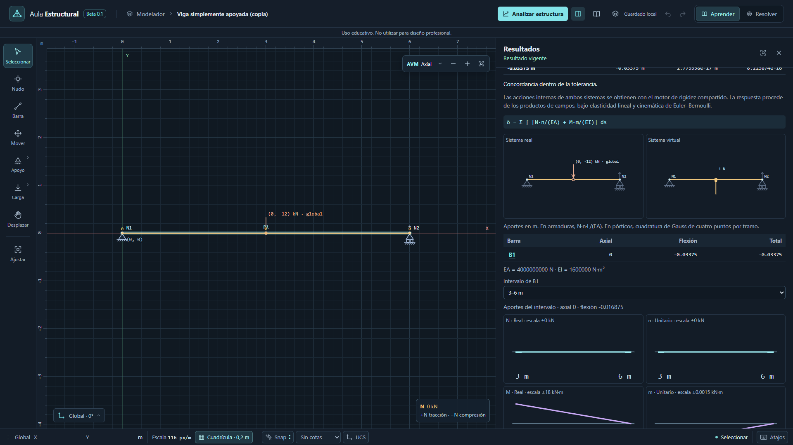

# Hito 7.1 · Trabajo virtual y carga unitaria

## Uso

1. Abre **Resultados** y selecciona **Trabajo virtual / carga unitaria** en **Método de análisis**.
2. Elige un nudo o una sección y la componente. Puedes seleccionar una entidad en el CAD y pulsar **Usar selección CAD**. Para una sección, indica s en metros desde el extremo inicial de la barra. La dirección arbitraria se mide en grados antihorarios desde +X global.
3. Pulsa **Analizar estructura**. En **Resolver** puedes consultar el valor integral, la referencia de rigidez y los errores. En **Aprender** aparecen los dos sistemas, la ecuación, la suma por barras, las contribuciones axial y flexional y la consulta de intervalos.
4. Pulsa el término de una barra para resaltarla en el CAD. El selector de intervalos muestra (N), (n), (M) y (m) en escalas rotuladas. **Muestras y pesos de integración** identifica las abscisas y los valores utilizados. En armaduras solo se muestran los campos axiales.

## Formulación y convenciones

El método usa elasticidad lineal de primer orden y elementos prismáticos Euler–Bernoulli. Para una traslación, el sistema auxiliar recibe 1 N en la dirección global unitaria. Para un giro activo recibe 1 N·m antihorario. El resultado es la respuesta conjugada en m o rad, con su signo. N positivo significa tracción y M positivo es sagante en la convención del corte local.

```text
δ = Σ barras ∫ [N(s)·n(s)/(EA) + M(s)·m(s)/(EI)] ds
δ axial de una barra de armadura = N·n·L/(EA)
```

Las acciones internas del caso activo y del sistema auxiliar se calculan con el solucionador elástico compartido. La respuesta de este método procede de los productos de campos. La salida por rigidez se usa para comprobar la concordancia y para mostrar el sistema real en el panel y los diagramas AVM existentes. La vista educativa muestra la expresión física y el registro de cuadratura numérica. Las curvas son una interpolación visual por intervalo a partir de las abscisas calculadas.

En un tramo regular de pórtico, (N) tiene grado ≤ 2 y (M) grado ≤ 3 bajo las cargas lineales del dominio. Gauss–Legendre de cuatro puntos es exacta hasta grado 7 en aritmética exacta, suficiente para los productos de grados 4 y 6. La unión de estaciones de ambos sistemas separa fuerzas puntuales y límites de cargas distribuidas. El extremo inicial se evalúa por derecha y el final por izquierda. Los valores se suman con compensación y se conservan en Float64. El redondeo se aplica en la presentación.

## Arquitectura, vigencia y límites

- La petición ampliada viaja al mismo Web Worker. El caso real valida geometría, cargas y propiedades antes de construir el auxiliar. La acción unitaria existe solo en una instantánea temporal. [Solución](../src/analysis/virtualWork.ts) · [Integración](../src/analysis/workIntegral.ts)
- Para una sección interior de pórtico se introduce un nudo temporal continuo, con dos subbarras coplanares y con los mismos E/A/I. La operación conserva las estaciones físicas de carga y remapea los intervalos al ID y s de la barra original. La referencia de rigidez se evalúa sobre la barra original sin subdividir. Los extremos exactos usan el grado nodal. Una división geométricamente no representable se diagnostica.
- La dirección, el objetivo y el caso activo forman parte de la vigencia. Zoom, paneo, modo Aprender/Resolver y navegación por integrales no cambian la revisión. El proyecto y la configuración de cálculo se separan. La configuración vive en la sesión y el documento conserva JSON v3 e IndexedDB.
- La comparación marca acuerdo cuando `|δ−δr| ≤ 1e−9 + 1e−7·max(|δ|,|δr|)`, en m o rad. Si la referencia es cero se muestra el error absoluto. El método no incluye cortante deformacional, segundo orden, acciones térmicas ni asentamientos. Las secciones interiores de armadura se diagnostican y pueden consultarse los grados nodales activos. Los mecanismos siguen rechazándose.

## Referencias y aceptación

Se protegió la línea base `def5e2a` con la etiqueta local `respaldo-hito-7`. La verificación inicial obtuvo 183 Vitest, 59 Playwright en Edge, TypeScript y compilación correctos. El sitio público anterior respondió HTTP 200.

| Caso | Referencia comprobada |
| --- | --- |
| Barra axial | +0,0001 m por PL/(EA). Se contrasta por separado la contribución nula de la segunda barra. |
| Armadura triangular | Carga unitaria por método de nudos, uy de N3 ≈ −0,000182907221937 m. |
| Voladizo | −0,036 m y −0,018 rad en punta. También se verifica el giro interior y una dirección global oblicua. |
| Viga con carga central | −0,03375 m por PL³/(48EI), corte unilateral y giro nulo en el centro. |
| Viga bajo carga uniforme | −0,010416666667 m por 5qL⁴/(384EI). |
| Voladizo bajo carga lineal | Flecha de magnitud 11qL⁴/(120EI). Caso activo aislado y cortes ante límites de distribución parcial. |
| Pórtico simple | ux ≈ +0,00238462270435 m por pendiente–deflexión con axial de columnas. |
| Respuesta bloqueada y restricciones | Giro cero en el empotramiento. Diagnóstico de giro sin grado activo y estación interior de armadura. |
| Interacción | Selección CAD, referencia y campos, cambio de tramo, Aprender/Resolver, vigencia y exportación idéntica. |

[Referencias de rigidez y derivación del pórtico](HITO_4_ANALYSIS_ARCHITECTURE.md#5-matriz-de-pruebas-de-referencia) · [Oráculos automatizados](../src/analysis/educationalMethods.test.ts) · [Playwright](../tests/e2e/methods.spec.ts)



**Verificación conjunta.** 204 pruebas Vitest, 62 Playwright en Edge, 62 en Chromium y 17 representativas en Firefox. TypeScript y la compilación de producción pasaron. Se conservan los oráculos previos.
