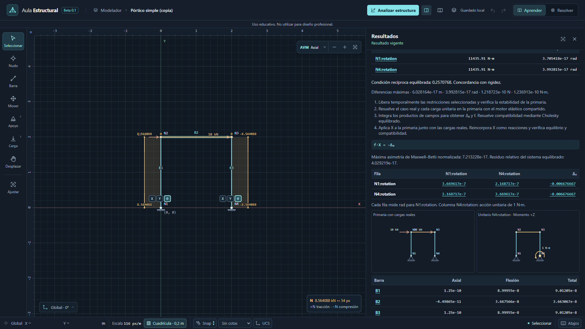

# Hito 7.2 · Método de las fuerzas

## Uso y restricciones

En **Resultados → Método de análisis**, elige **Método de las fuerzas**. Pulsa X, Y, θ o n junto a un apoyo en el CAD, o utiliza las casillas de **Redundantes**. Los símbolos permiten teclado. Cada opción muestra el ID, el tipo de apoyo, la dirección y la acción conjugada. Para un rodillo inclinado se utiliza la normal global unitaria ((-sin alpha,cos alpha)) de la superficie.

Las selecciones se proponen antes de calcular. **Analizar estructura** valida la primaria y las condiciones de compatibilidad. Si aparece un mecanismo, el diagnóstico identifica las restricciones propuestas y el grado o componente revelado por el solucionador cuando está disponible. En **Resolver** se muestran las acciones redundantes, las comprobaciones y los resultados estructurales recuperados. **Aprender** añade los sistemas, las ecuaciones y la matriz. Pulsa una celda o Δ₀ para consultar las contribuciones por barras y resaltar la entidad en el CAD.

## Procedimiento

1. Construir el sistema primario en memoria liberando únicamente las restricciones elegidas. Los apoyos persistidos quedan intactos. El ensamblaje admite temporalmente un bloqueo de giro independiente de las restricciones traslacionales. Así, por ejemplo, se puede liberar X e Y de un empotramiento y conservar su giro bloqueado.
2. Resolver la primaria con las cargas reales y con una acción unitaria por redundante. Las acciones internas provienen del motor elástico compartido.
3. Integrar los productos de campos. Para Δ₀ se cruzan los campos reales con los unitarios. Para (f_{ij}) se cruzan los campos de los dos unitarios. La integración conserva los aportes axial y flexional por barra y tramo. [Regla de integración](HITO_7_1_VIRTUAL_WORK.md)
4. Resolver `f·X = −Δ₀` por Cholesky con equilibrado diagonal. El pivote y la condición estimada descartan sistemas singulares o mal condicionados. Se informa el recíproco de condición y el residuo. La factorización no necesita inversión explícita, pseudoinversa ni rigideces artificiales.
5. Recuperar la respuesta por superposición resolviendo la primaria con las cargas reales más X. En la presentación, X se reincorpora a las reacciones originales con sus componentes globales. Los campos resultantes alimentan AVM. La comprobación de equilibrio que incluye dichas acciones es equivalente a la del modelo restaurado al reclasificarlas como reacciones. El resultado de rigidez original sirve de referencia independiente.

La simetría de los productos se conserva al armar (f). Se comprueba además Maxwell–Betti con los desplazamientos conjugados calculados por separado en los sistemas unitarios. Tanto la asimetría como la diferencia energética se comprueban respecto a `sqrt(fii)·sqrt(fjj)` con límite relativo `1e−7`. La compatibilidad se verifica sobre la primaria reconstruida con tolerancia `1e−9 + 1e−7·Σ|términos|` en m o rad. Para la comparación final se contrastan desplazamientos, giros, reacciones y campos con piso `1e−9` para m/rad o `1e−6` para N/N·m y margen relativo `1e−7`.

## Alcance y datos

La variante inicial admite un máximo de ocho coordenadas de apoyo activas por consulta. La primaria debe ser estable. Puede conservar hiperestaticidad si el estudiante elige un subconjunto de redundantes. Como las acciones internas se resuelven con el motor existente, se puede estudiar el efecto de ese subconjunto. Las liberaciones internas y las deformaciones impuestas quedan pendientes. Un modelo isostático no admite una liberación estable de una restricción necesaria. Repetir una restricción se diagnostica como dependencia.

El Worker devuelve sistemas y verificaciones vinculados a IDs originales. Un cambio físico, del caso o de las redundantes invalida la respuesta. Seleccionar un término, cambiar de modo o navegar el CAD conserva el historial. Las opciones metodológicas viven en la sesión. JSON e IndexedDB conservan sus versiones.

## Matriz de aceptación

| Caso | Referencia |
| --- | --- |
| Viga empotrada–apoyada, q uniforme | X = 3qL/8 = 7500 N, f = L³/(3EI), Δ₀ = −qL⁴/(8EI), Mz de empotramiento = 10 000 N·m. |
| Viga continua de dos vanos iguales | Reacción intermedia 5qL/4 = 25 000 N y M intermedio −qL²/8 = −10 000 N·m. |
| Pórtico con una y dos redundantes | Momentos de empotramiento ≈ +11 435,9121 N·m por pendiente–deflexión. La matriz de dos coordenadas conserva reciprocidad. |
| Rodillo inclinado | Para un voladizo con rodillo a 45°, f combina la flexibilidad axial y flexional en la dirección de la normal. Se contrastan X y ambas componentes globales de reacción. |
| Giro retenido sin traslaciones retenidas | Viga de extremos empotrados bajo carga uniforme. Al liberar X/Y de un extremo, se recupera Ry = qL/2 y se conserva Mz = qL²/12 en el apoyo. |
| Diagnósticos | Primaria con mecanismo, redundante repetida, ID fuera del modelo y selección vacía. |
| Interfaz | Selección gráfica y teclado, matriz y aportes, AVM recuperado, Aprender/Resolver, vigencia y geometría intacta. |

[Método y recuperación](../src/analysis/forceMethod.ts) · [Oráculos](../src/analysis/educationalMethods.test.ts) · [Pruebas de navegador](../tests/e2e/methods.spec.ts)

**Verificación conjunta.** 204 pruebas Vitest, 62 Playwright en Edge, 62 en Chromium y 17 representativas en Firefox. TypeScript y la compilación de producción pasaron. El incremento está preparado localmente y la publicación sigue pendiente.
