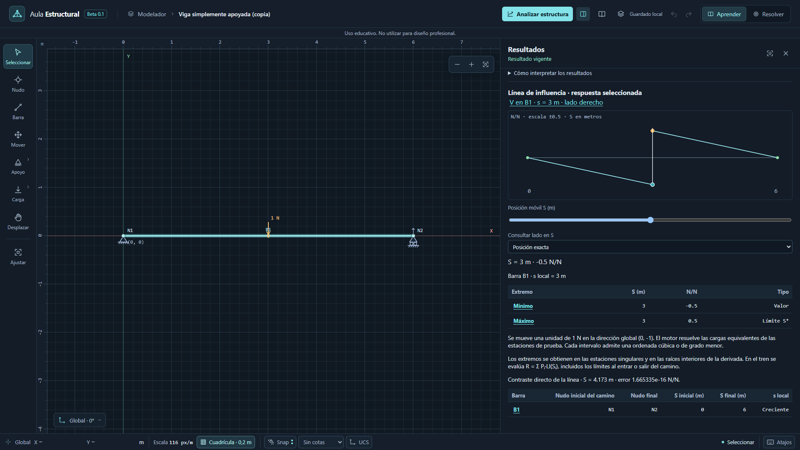

# Hito 7.3 · Líneas de influencia y cargas móviles

## Consulta

Abre **Resultados → Método de análisis → Líneas de influencia**. Introduce los IDs de barras en orden de avance o selecciona las barras en el CAD y usa **Usar barras del CAD**. El camino puede invertirse. Elige la respuesta fija, su entidad, dirección global o estación local de corte. La carga unitaria apunta hacia −Y global por defecto. Pulsa **Analizar estructura** y desplaza el cursor de la gráfica o el control de S. El lienzo resalta el camino y ubica la carga.

Para un tren, habilita **Configurar tren**, indica su ID, nombre, sentido y ejes. Cada eje tiene una fuerza firmada en kN y una distancia no negativa, medida hacia atrás desde la referencia. Al menos un eje debe estar a distancia cero. En **Carga mostrada** se alterna entre unitaria y tren. **Mínimo** y **Máximo** fijan S en el valor o límite indicado por la tabla. Los ejes fuera del camino se informan sin aplicarse al modelo.

## Método

- Se obtiene una cadena abierta de barras de pórtico mediante IDs compartidos. La lista es explícita. Puede seguir una de las ramas en una unión, pero una lista ramificada, desconectada o cíclica produce un diagnóstico. Dos nudos coincidentes conservan su identidad y jamás completan un camino por proximidad.
- Cada tramo conserva el sentido de su barra. `s = S − S₀` si coincide con el del recorrido y `s = L − (S − S₀)` si es contrario. Una carga exactamente en un nudo se transmite una sola vez. El corte conserva su convención local.
- La carga se evalúa en casos temporales de 1 N con el motor existente y sus cargas consistentes. En el interior de un tramo, el vector equivalente de Euler–Bernoulli es polinómico de grado máximo tres en la posición móvil. La respuesta lineal y el aporte directo de una carga puntual al corte también lo son. Se separa en los nudos del camino y en la posición de un corte perteneciente al camino.
- Cuatro abscisas interiores determinan el polinomio. Se lo contrasta con una quinta posición distinta en cada tramo. El valor exacto de cada estación singular se resuelve por separado y se retienen los límites de los tramos vecinos. Un salto no se dibuja como una curva continua. Los ceros se localizan por bisección en ramas monótonas y los extremos interiores se obtienen de las raíces del polinomio derivado; los valores en estaciones singulares y sus límites completan los candidatos. Las diferencias en los límites inferiores a la tolerancia de redondeo se consideran coincidentes.
- **Ordenada** mide la respuesta por N de fuerza móvil. **Respuesta del tren** mide la magnitud física. Para un tren paralelo, `R = Σᵢ Pᵢ · LI(Sref − σ dᵢ)`, con `σ = ±1`. Los eventos trasladados por cada eje incluyen entrada, salida, nudos y corte. Entre dos eventos la suma conserva grado máximo tres, por lo que se evalúan sus extremos interiores y ambos límites. Se conserva la respuesta nula fuera del camino y se distingue un límite de un valor alcanzado exactamente. La búsqueda es exhaustiva para esas piezas en Float64, con las tolerancias de representación descritas. Las comparaciones incluyen una resolución directa del tren con los ejes activos.

## Alcance

La implementación inicial admite 24 barras en el recorrido, 160 grados activos y hasta 16 ejes paralelos a la dirección unitaria configurada. Cada fuerza puede tener magnitud y signo distintos. Los ejes con direcciones independientes quedan para una ampliación. Las barras de armadura quedan fuera del camino, pues su formulación no admite una fuerza transversal interior; puede consultarse su axial si la carga se desplaza sobre otros elementos compatibles. El análisis ignora las cargas estáticas del proyecto para aislar la influencia. Compila las piezas en el Worker y las reutiliza durante el movimiento. La compilación usa el solucionador completo en las abscisas de prueba; no se almacena una factorización global adicional.

Se diagnostica si el desplazamiento de un eje o la inversión impiden distinguir estaciones físicamente distintas en Float64.

La configuración vive en la sesión. Cambiar la geometría, el objetivo, la unidad o la definición del tren invalida el resultado. Mover S, consultar un límite, señalar una barra y cambiar Aprender/Resolver conservan la revisión. JSON v3, IndexedDB e historial conservan sus contratos. La gráfica y el indicador móvil son independientes de AVM.

La quinta evaluación acepta una diferencia máxima de `10⁻¹⁰ + 2·10⁻⁷ × escala` en unidades de ordenada, con la escala dada por el mayor valor absoluto entre la ordenada directa y los coeficientes del tramo. Para el tren, la diferencia se verifica contra la solución simultánea de los ejes con tolerancia de `10⁻⁸ + 2·10⁻⁷ × escala` en unidades físicas de respuesta. Su escala contempla la suma de magnitudes por eje y la mayor ordenada absoluta.

## Matriz de aceptación

| Caso | Referencia independiente o prueba |
| --- | --- |
| Viga simplemente apoyada, reacciones izquierda y derecha | `1 − a/L` y `a/L`. |
| Cortante en 3 m de una viga de 6 m | `V = −a/L` antes del corte y `V = 1 − a/L` después. Límites −0,5 y +0,5; valor exacto según el lado consultado. |
| Momento interior | En el centro, máximo de 1,5 N·m por N para L = 6 m. |
| Viga continua de dos vanos | Reacción central `a(3L² − a²)/(2L³)` por compatibilidad del apoyo intermedio. Barra invertida incluida. |
| Voladizo | Flecha de extremo `−a²(3L − a)/(6EI)`, giro `−a²/(2EI)` y respuesta axial bajo unidad horizontal. |
| Extremo interior | Giro del apoyo izquierdo de una viga simple extremal en `a = L(1 − 1/√3)`. |
| Trenes | Dos ejes de 10/20 N a 2 m producen máximo de 35 N·m; tres de 10/20/30 N producen 55 N·m en el caso ensayado. Entrada, salida y sentido inverso incluidos. |
| Topología e interfaz | IDs coincidentes, bifurcación, camino inválido, sincronización gráfica CAD, cambio de configuración y ausencia de edición física. |

## Verificación

La línea base del repositorio se conservó en la etiqueta local `respaldo-hitos-7.3-7.4` (`9b9da57`). Los casos analíticos nuevos comprueban la respuesta obtenida con fórmulas independientes. La prueba de interfaz recorre el corte con salto de cortante, consulta un límite de entrada, verifica el máximo del tren y comprueba que una edición invalida la respuesta.

La validación conjunta de ambos incrementos incluye 219 pruebas Vitest, la suite completa de Playwright en Edge y Chromium (65 por navegador), la verificación de tipos y la compilación de producción. [Detalle de la comprobación en Firefox](HITO_7_4_MOMENT_DISTRIBUTION.md#verificación)

[Cálculo y validación de estaciones](../src/analysis/influence.ts) · [Polinomios, límites y extremos](../src/analysis/influenceCurve.ts) · [Oráculos](../src/analysis/movingMethods.test.ts) · [Pruebas de navegador](../tests/e2e/movingMethods.spec.ts)

