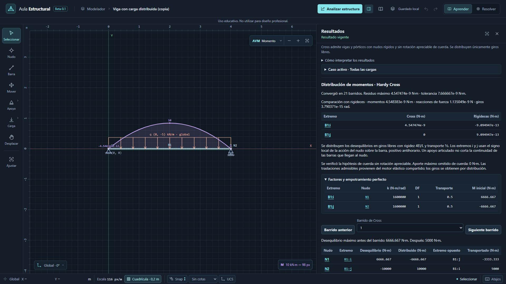

# Hito 7.4 · Distribución de momentos de Hardy Cross

## Uso

Elige **Resultados → Método de análisis → Distribución de momentos** y analiza el caso activo. **Resolver** muestra momentos finales, comprobación matricial, reacciones y AVM. En **Aprender**, abre **Factores y empotramiento perfecto** para ver los datos de cada extremo. Elige el barrido cero para consultar los momentos iniciales o navega de uno en uno con **Siguiente barrido** y **Barrido anterior**. Las tablas vinculan nudos y barras con el CAD.

## Formulación

Los momentos se expresan en N·m como acciones de extremo del nudo sobre la barra. Positivo es antihorario. En la convención de la sección recuperada, `M(0⁺) = −Mᵢ` y `M(L⁻) = Mⱼ`. Los momentos iniciales son los componentes rotacionales negativos de la carga nodal equivalente local. El motor ya integra la carga puntual, uniforme, lineal o parcial.

En cada distribución se mantiene fijo el extremo opuesto para obtener `k = 4EI/L` y transporte de `1/2`. Se distribuyen solo giros activos libres. La variante por barridos equilibra los extremos libres cuando les toca el turno; eso incluye los nudos de apoyo simple. El uso de `3EI/L` exigiría condensar una articulación efectiva; el procedimiento implementado mantiene la continuidad rotacional de todas las barras conectadas.

En un nudo libre se calcula `D = Σ Mᵢ − M aplicado`. El incremento angular es `−D/Σ kᵢ`. Cada extremo recibe `−D · kᵢ/Σ kᵢ` y transporta la mitad de ese incremento al extremo opuesto. Se guarda el desequilibrio, la corrección, el incremento angular, las distribuciones, transportes y momentos acumulados por barrido.

El residuo es el mayor desequilibrio absoluto de giro libre después de un barrido. Se acepta cuando es menor o igual a `10⁻⁹ + 10⁻¹² Mref` N·m, con referencia basada en la escala de momentos del caso y piso de 1 N·m. Se admite un máximo de 200 barridos y se diagnostica la falta de convergencia. Se comprueban las sumas de factores.

## Hipótesis y recuperación

Se admiten pórticos Euler–Bernoulli prismáticos y vigas de nudos rígidos sin rotación apreciable de cuerda. El solucionador compartido valida la estabilidad y aporta las traslaciones compatibles. Se comprueba por barra que `|6EI Δv/L²| ≤ 10⁻⁷ + 10⁻⁸ Mref` N·m. Así también se rechaza una diferencia de traslaciones verticales en una cuerda horizontal que introduciría flexión apreciable. Las traslaciones axiales compatibles pueden conservarse. Un pórtico con traslación lateral incompatible recibe un diagnóstico; no se añaden rigideces ni se bloquean grados de manera artificial.

Se reinician los giros antes de distribuir y se reconstruyen con los incrementos de Cross. Con los giros de Cross y las traslaciones compatibles se recuperan reacciones y campos mediante el ensamblaje y la recuperación existentes. Se comprueba equilibrio global, residuo libre, compatibilidad y condiciones de extremo antes de exponer AVM. Los momentos iterados se contrastan con la recuperación y con los momentos de la solución matricial. Esta referencia no sustituye la iteración.

Quedan fuera los elementos de armadura, las liberaciones internas, traslación lateral que exija un análisis de Cross con desplazamientos, asentamientos y segundo orden. Los barridos son de solo lectura, corren en el Worker y no modifican el documento, JSON v3 ni Undo/Redo.

## Matriz de aceptación

| Caso | Evidencia de referencia |
| --- | --- |
| Vigas continuas con q uniforme | Dos vanos iguales, `M apoyo = −qL²/8`. Tres vanos iguales, `M apoyo = −qL²/10`. Se verifican también reacciones exteriores. |
| Pórtico sin cuerda apreciable | Pórtico simétrico con X restringida en los nudos superiores y bases empotradas. Los momentos de base son `∓qL²/36`, por pendiente–deflexión. |
| Puntual, parcial y variable | Se compara con los momentos analíticos de una carga puntual excéntrica y con las primitivas de las funciones de Hermite por tramos. |
| Distribución y transporte | La suma de DF en un giro libre es uno. Cada corrección distribuida equilibra el nudo y su transporte es la mitad. |
| Convergencia y comparación | Residuo bajo la tolerancia, recuperación de campos y diagnóstico de mecanismo o rotación de cuerda. |
| Interacción académica | Navegar barridos, seleccionar una barra, ver AVM y reacciones, alternar modos y conservar el historial. |

## Verificación

Los casos de interfaz comprueban los barridos, el diagrama recuperado y el rechazo de un pórtico con traslación lateral. Los casos analíticos de Cross se ejecutan junto con los de influencia y la regresión de los hitos anteriores.

Pasaron 219 pruebas Vitest, 65 de Playwright en Edge, 65 en Chromium y una selección de 20 en Firefox. También pasaron la verificación de tipos y la compilación de producción. La ejecución de Firefox con dos trabajadores registró dos fallos y un error del compositor gráfico. Los dos casos y el resto de la selección pasaron al repetir la prueba con un trabajador, sin cambios de código.

[Solución de Cross](../src/analysis/cross.ts) · [Oráculos](../src/analysis/movingMethods.test.ts) · [Pruebas de navegador](../tests/e2e/movingMethods.spec.ts)

