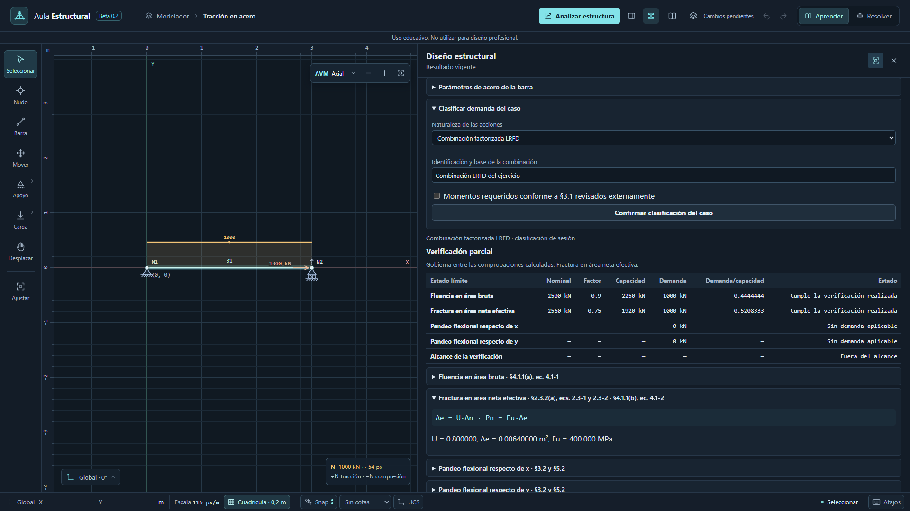

# Hito 8.2 · Verificaciones de acero con E.090

## Fuente y alcance

La implementación se basa en **RNE E.090 Estructuras Metálicas**, aprobada con el Reglamento Nacional de Edificaciones mediante D.S. N.° 011-2006-VIVIENDA y consultada en el texto oficial enlazado por el MVCS. Al 22 de noviembre de 2026 el índice oficial consultado identifica E.090 sin una modificación particular. El D.S. N.° 015-2022-VIVIENDA deroga el artículo 7 del decreto de aprobación y no reemplaza las ecuaciones de E.090 usadas aquí. La R.M. N.° 183-2026-VIVIENDA corresponde a E.030. Las referencias que E.090 recoge en §1.6 incluyen ASTM A36-91, ASTM A572-91 y la edición 1993 de la especificación AISC para ángulos simples. La implementación usa las expresiones de E.090 y deja los ángulos y otras remisiones fuera del alcance calculado. [Índice del MVCS](https://www.gob.pe/institucion/vivienda/informes-publicaciones/2309793-reglamento-nacional-) · [E.090 oficial](https://cdn.www.gob.pe/uploads/document/file/2686420/E.090%20Estructuras%20Met%C3%A1licas.pdf) · [D.S. 015-2022-VIVIENDA](https://www.gob.pe/institucion/vivienda/normas-legales/3846052-015-2022-vivienda) · [R.M. 183-2026-VIVIENDA](https://www.gob.pe/institucion/vivienda/normas-legales/8081915-183-2026-vivienda)

El cálculo es educativo y está limitado a los estados indicados para una barra, un lado del corte y una estación. **Verificación parcial** identifica las comprobaciones pendientes. Las conclusiones se limitan a cada estado calculado. La base recuperable es `6be58b2`, que contiene Hito 8.1 y la corrección móvil de la segunda beta.

## Flujo y trazabilidad

1. Abre **Diseño estructural → Acero**. Selecciona una barra y analiza el caso.
2. Guarda las resistencias del material vinculado y declara el grado en **Parámetros de acero de la barra**. Se admiten ASTM A36 y ASTM A572 grado 50 en el flujo educativo. Fy y Fu proceden de los datos declarados. La aplicación no obtiene valores resistentes del módulo E ni los deduce de la etiqueta ASTM.
3. Selecciona **LRFD** o **ASD**. La comparación se habilita al declarar explícitamente la combinación compatible y su base para la revisión vigente. Con acciones nominales, de servicio, sin clasificar, incompletas o del otro método se presentan las resistencias disponibles y la comparación queda **No evaluado**. El programa usa las acciones tal como llegan del análisis y no genera combinaciones. Para la interacción con compresión exige una revisión externa de las acciones requeridas por §3.1.
4. Consulta cualquiera de los extremos individuales de N, V y M que proporciona la evaluación AVM. **Ver sección en AVM** traslada el corte al diagrama. La interacción se calcula con las acciones simultáneas en esa estación. Los extremos individuales no constituyen una envolvente de interacción.
5. En **Aprender**, despliega cada estado para consultar su expresión, sustitución, fuente y diagnóstico. El valor gobernante se elige entre los cocientes calculados de la estación.

Los contratos de acero contienen grado, método, condiciones, resultados y referencias. El evaluador consume la consulta vigente de Hito 8.1 y las propiedades vinculadas. Conserva el ID del proyecto, caso, barra, estación, lado y revisiones del análisis. El vínculo a material y sección es el mismo de la consulta de diseño. Los cambios físicos invalidan el análisis. Cambiar método, geometría de conexión, parámetros de estabilidad o resistencias vuelve a evaluar las comprobaciones con los datos vigentes. El motor, el Worker y la recuperación de AVM se mantienen.

## Matriz normativa

Las magnitudes resistentes internas son N, N·m, Pa y m. La aplicación presenta N en kN, momentos en kN·m, resistencias de material en MPa y área de conexión en cm². Se usa Fy en MPa únicamente en ecuaciones empíricas que lo exigen, con `1 MPa = 10⁶ Pa`. N positivo es tracción. La compresión y las demandas de V y M se comparan por magnitud donde corresponde. Los ejes x e y de pandeo se refieren a los ejes centroidales de la sección, con Ixx e Iyy respectivamente.

| Estado | LRFD | ASD | Requisitos y delimitación |
| --- | --- | --- | --- |
| Fluencia a tracción | §4.1.1(a), ec. 4.1-1. `Pn = Fy·Ag`, φ = 0,90. | §4.1.2. `Pa = 0,60Fy·Ag`. | Área bruta asignada y Fy explícito. |
| Fractura a tracción | §4.1.1(b), ec. 4.1-2. `Pn = Fu·Ae`, φ = 0,75. | §4.1.2. `Pa = 0,50Fu·Ae`. | An declarado según §2.2. Transferencia directa a todos los elementos, `Ae = An` (§2.3.1). Para transferencia parcial solo por pernos, `Ae = U·An` y `U = min(0,90, 1−e/l)` (§2.3.2(a), ecs. 2.3-1/2). El usuario declara el descuento de agujeros y la sección neta controlante. |
| Pandeo flexional x e y | §5.2.1, ecs. 5.2-1 a 5.2-4. `λc = KL/(πr)·√(Fy/E)`. Para λc ≤ 1,5, `Fcr = Fy·0,658^(λc²)`. Para λc > 1,5, `Fcr = 0,877Fy/λc²`. `Pn = Ag·Fcr`, φ = 0,85. | §5.2.2, ecs. 5.2-5/6. `Cc = π√(2E/Fy)`, `t = (KL/r)/Cc`. Para t ≤ 1, `Fa = Fy(1−t²/2)/(5/3+3t/8−t³/8)`. Si t > 1, `Fa = 12π²E/[23(KL/r)²]`. `Pa = Ag·Fa`. | Rectángulo macizo o I soldada no esbelta dentro del filtro. Se solicita L, K y condición de extremo por eje. `r = √(I/Ag)`. La aplicación no deduce K de los apoyos 2D. |
| Clasificación geométrica | §2.5.1 y tabla 2.5.1. | Mismo origen geométrico con ramas de resistencia propias. | Rectángulo macizo o I homogénea soldada con alas iguales y unión continua. Para compacidad de I se adopta `bf/(2tf) ≤ 170/√Fy(MPa)` y el filtro conservador `h/tw ≤ 665/√Fy(MPa)` que cubre el mínimo de alma en flexocompresión. Para la rama no esbelta de compresión se usan `285√kc/√Fy(MPa)` en el ala y `665/√Fy(MPa)` en el alma. `kc = 4/√(h/tw)` limitado a [0,35; 0,763]. Los límites rechazados quedan como verificación incompleta. |
| Fluencia en flexión | §6.1.1.1, ec. 6.1-1. `Mn = min(Fy·Z, 1,5Fy·S)`, φ = 0,90. | §6.1.2.2a, ec. 6.1-27. `Ma = 0,75Fy·S` únicamente para rectángulo macizo sobre su eje menor o sección cuadrada. | Flexión uniaxial principal conforme a §6.1.1, con restricción de torsión o carga en el plano admitido declarada. Z se calcula por áreas de un rectángulo macizo o una I doblemente simétrica. S procede de las fibras del Hito 8.1. |
| Pandeo lateral-torsional | §6.1.1 y §6.1.1.2a, ec. 6.1-4. Para I compacta, `Lp = 788ry/√Fy(MPa)` y se verifica `Lb ≤ Lp`. | Se admite flexión de rectángulo en eje menor en la rama anterior. | La E.090 excluye este modo sobre el eje menor y en perfiles cuadrados. Para eje mayor, la comprobación queda incompleta si falta Lb o si excede Lp. Rectángulos no cuadrados sobre eje mayor requerirían J y las ramas correspondientes. |
| Cortante de alma | §6.2.1 y §6.2.2.1, ecs. 6.2-1/2/3, φ = 0,90. `Aw = d·tw`. Hasta `h/tw = 1098/√Fy(MPa)` aplica `0,60Fy·Aw`. Hasta `1373/√Fy(MPa)` multiplica por el primer límite dividido entre h/tw. El tercer intervalo aplica `Aw·910000 MPa/(h/tw)²` hasta 260. | §6.2.2.2, ec. 6.2-4. `Va = 0,40Fy·Aw` hasta `1000/√Fy(MPa)`. | I soldada homogénea y simétrica, sin rigidizadores confirmados y cortante en el plano del alma para el eje mayor x. |
| Interacción axial y flexión | §§8.1.1.1/2, ecs. 8.1-1a/b. Si `p ≥ 0,20`, `p + 8m/9`. Si `p < 0,20`, `p/2 + m`. | En tracción, §8.1.2.1 ec. 8.1-2a, `p + m`. En compresión, §8.1.2.2 ec. 8.1-2d, `p + m` solo si `p ≤ 0,15`. | p y m son las demandas divididas por las capacidades aplicables. Tracción exige ambas resistencias. Flexocompresión admite rectángulo macizo con ambos ejes de pandeo y momentos de §3.1 declarados. M mayor necesita la rama lateral cubierta. Las capacidades incompletas bloquean la ecuación. |

## Pendientes y diagnósticos

| Pendiente | Comportamiento |
| --- | --- |
| Conexiones y bloques de cortante, pasadores, fatiga, sistema 3D, cargas concentradas | Fuera del alcance. La salida permanece parcial. |
| An, Fu o datos de transferencia ausentes | Fractura no evaluada. No se infieren agujeros ni reducciones. |
| K, L o condiciones de extremo ausentes | No evaluado por eje. El otro eje mantiene su cálculo individual si procede. |
| Pandeo flexotorsional de I y otras secciones abiertas | Fuera del alcance de §5.3. Se conserva separado del pandeo flexional. |
| Placas esbeltas y clasificación fuera del filtro conservador | No se evalúan con fórmulas para elementos compactos o no esbeltos. |
| Lb mayor que Lp, J, Cw, efectos de arriostramiento general | Verificación incompleta de pandeo lateral-torsional. |
| Cortante ASD en ramas esbeltas, almas con rigidizadores y otras secciones | Fuera de las ramas implementadas. |
| Generador de combinaciones, segundo orden, flexión biaxial | El módulo actual solicita una declaración externa y usa una sola componente de flexión. |

## Persistencia

JSON v5 agrega `design.steel` con las configuraciones por ID de barra. Se migran v1 a v4 preservando geometría, mecánica, biblioteca y configuración elástica previa. La configuración incluye una revisión de los extremos y la asignación. Si cambian, se mantienen los campos editables y las verificaciones afectadas quedan pendientes hasta confirmarlos. Esto también impide reutilizar parámetros al recrear una barra distinta con un ID restaurado por Undo. Los datos de resistencia existentes conservan Pa. La declaración de demanda depende de la consulta y revisión actual y se rehace al reabrir. Los parámetros confirmados se guardan en IndexedDB y JSON. Los resultados y la declaración de demanda quedan fuera del archivo. El sitio público de Beta 0.2 conserva JSON v4.

## Oráculos y aceptación

| Caso | Referencia |
| --- | --- |
| Tracción LRFD | Ag = 0,01 m², An = 0,008 m², e/l = 0,20, Fy/Fu = 250/400 MPa. Fluencia 2250 kN y fractura 1920 kN. Con 2000 kN gobierna y excede la fractura. Sin An se bloquea ese cociente. |
| Tracción ASD | An directa = 0,006 m². Capacidades de 1500 y 1200 kN. Una declaración LRFD no habilita ASD. |
| Columna | Rectángulo de 0,20 × 0,40 m. Radios 0,40/√12 y 0,20/√12. Con Lx = 0,10 m y Ly = 12 m, el segundo eje coincide con 0,877 veces la carga de Euler antes de φ. La prueba ASD verifica sus dos regímenes. |
| Flexión y cortante | I de 150 × 300 mm, tf = 20 mm y tw = 10 mm. Zx = 0,001009 m³. Para Fy = 250 MPa y Lb = 0,5 m, fluencia `φMn = 227,025 kN·m` y cortante `φVn = 405 kN`. Oráculos para cada tramo de cortante LRFD. |
| Interacción | p = 0,10 o 0,35 y m = 0,60 comprueban las dos expresiones LRFD. Un rectángulo sobre eje menor comprueba la interacción ASD. Flexocompresión queda pendiente hasta declarar la revisión de §3.1. |
| Vigencia y persistencia | Sin N, V y M vigentes se ocultan números anteriores. Una declaración con revisión distinta bloquea cocientes. Guardado, recarga, migración v4 y exportación v5 mantienen datos confirmados. |

[Contratos](../src/design/steel/contracts.ts) · [Ecuaciones](../src/design/steel/e090.ts) · [Evaluación](../src/design/steel/evaluate.ts) · [Oráculos](../src/design/steel/steel.test.ts) · [Prueba de interfaz](../tests/e2e/steel.spec.ts)

La línea base de Beta 0.2 pasó 246 Vitest, 68 Playwright en Edge, 68 en Chromium y 23 representativas en Firefox, además de TypeScript y producción. Chromium se comprobó en Linux en el despliegue de esa beta. El incremento de acero añade oráculos de ramas normativas, pruebas de vigencia por revisión y pruebas de interfaz de tracción, corte crítico y migración.

| Puerta | Verificación final |
| --- | --- |
| A · Normativa, demandas y tracción | Conforme. Fuente oficial por estado, oráculos de fluencia y fractura y bloqueo de cocientes con declaración incompatible. |
| B · Compresión y pandeo global | Conforme en los casos documentados. Radios separados, curvas LRFD y ASD y diagnóstico de datos faltantes fuera del plano. |
| C · Flexión, cortante e interacción | Conforme en las ramas implementadas. La tabla de pendientes deja visible cada hipótesis fuera de alcance. |
| D · Interfaz, revisión y persistencia | Conforme. Dos escenarios de navegador cubren declaración, exportación v5, recarga, cambios físicos y vínculo con AVM. La captura muestra los valores del ensayo con los vínculos normativos. |
| Regresión | 263 Vitest, 70 Playwright en Edge, 70 en Chromium y 25 representativas en Firefox en serie. TypeScript y producción correctos. La salida del Worker se conservó. |

Durante el desarrollo, un pase de Firefox leyó el nuevo test de reconfirmación antes de que se regenerara el ejecutable que debía probar. Se repitieron las suites sobre la compilación final y pasaron.

**Dictamen. Hito 8.2 verificado dentro del alcance documentado.** Cada conclusión se refiere al estado y estación calculados. Las comprobaciones pendientes mantienen el resultado como verificación parcial. El incremento queda en el repositorio local.
